# Detailed architecture: Teams-backed chat reference implementation

| Field | Value |
| --- | --- |
| Status | Draft implementation-level architecture |
| Version | 0.1 |
| Documentation reviewed | 2026-10-15 |
| Implementation status | Target reference architecture with bounded [Live-only Sweden Development](dev-guide.md); real Teams functional evidence is recorded separately from production capacity, policy and recovery acceptance |
| Requirements and targets | [Technical design](technical-design.md) |
| Decisions and consequences | [Architecture decision records](adr/README.md) |

This document explains how the reference design can be assembled and how its components interact. It does not replace the TDD's workload assumptions, SLIs/SLOs, Graph limit snapshot, or production acceptance gates.

## Contents

- [1. Scope and architectural boundaries](#1-scope-and-architectural-boundaries)
- [2. Azure deployment architecture](#2-azure-deployment-architecture)
- [3. Entra and security architecture](#3-entra-and-security-architecture)
- [4. Software architecture](#4-software-architecture)
- [5. Data architecture and contracts](#5-data-architecture-and-contracts)
- [6. Main interaction flows](#6-main-interaction-flows)
- [7. Failure and recovery behavior](#7-failure-and-recovery-behavior)
- [8. Deployment and operations](#8-deployment-and-operations)

## 1. Scope and architectural boundaries

### 1.1 Relationship to the reference design

| Concern | Source of truth |
| --- | --- |
| Functional/nonfunctional requirements and capacity assumptions | [TDD requirements and workload](technical-design.md#2-requirements) |
| SLO values and measurement populations | [TDD SLIs/SLOs](technical-design.md#4-slis-and-proposed-slos) |
| Published Graph constraints | [TDD Graph bottlenecks](technical-design.md#5-microsoft-graph-constraints-and-bottlenecks) |
| Accepted reference decisions | [ADR index](adr/README.md) |
| Components, interfaces, runtime responsibilities, and sequence details | This document |
| Deployment approval | Evidence for [TDD gates G1-G7](technical-design.md#113-acceptance-gates) |

The cookie-BFF authentication pattern, contract shapes, partition layout, and delivery details below describe the target reference architecture. The current Live-only Development implementation and its deliberate limits are recorded in the [runtime contract](live-runtime.md); ADR 0008 preserves the retired simulator decision as history. Neither the code nor these diagrams imply production capacity/policy/recovery certification.

The component layouts, content-bearing records, and synchronization flows describe the proposed bounded Cosmos DB projection, option P07 in the [privacy and storage comparison](#56-privacy-and-storage-options). It requires explicit privacy approval. Other options are alternatives to assess, not already implemented modes or automatic fallbacks.

The initial deployment serves one approved Microsoft 365 tenant per environment. Data and identity contracts still carry `tenantId` to prevent accidental mixing. Supporting additional tenants requires separate onboarding, consent, isolation, and aggregate Graph-capacity review.

### 1.2 Responsibilities and trust boundaries

| Boundary | Responsibility |
| --- | --- |
| Browser to public application edge | Untrusted requests; authenticated application session; CSRF protection for mutations |
| Edge to application origins | Private origin connectivity, validated routing/host headers, HTTPS, and independent application authentication |
| Interactive to unattended permissions | Delegated user actions remain separate from app-only ingestion |
| Azure application to Microsoft 365 | Graph remains authoritative for Teams messages; Azure cannot expand its permissions or capacity |
| Projection to end user | Copied content needs application authorization, history/policy checks, and freshness evidence |
| Backend to Web PubSub | Service authorization controls publishing, negotiation, groups, and connection closure |
| Web PubSub to browser | Short-lived connection capability, server-controlled subscriptions, and authorized catch-up |
| Active region to recovery region | Explicit ownership, state continuity, authorization readiness, and dispatch fencing |

Public callback endpoints are service-to-service interfaces, not anonymous application APIs. Graph callback validation and Web PubSub upstream authentication are different protocols and use different routes.

### 1.3 Diagram conventions

Component views run top-to-bottom and show one concern at a time. Sequence diagrams use vertical time and short participant names; cross-references replace large, unreadable end-to-end diagrams.

An arrow in a component view represents a dependency or permitted path, not an assertion that every request traverses every component. Sequence diagrams show runtime ordering, including important failure branches.

## 2. Azure deployment architecture

### 2.1 Public ingress and private application origins

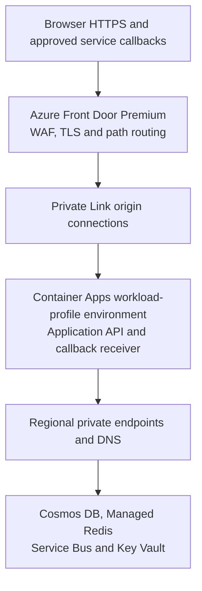

The diagram deliberately excludes direct browser WebSocket connections, worker internals, and Entra token acquisition; these are detailed separately.

Front Door Premium supports Private Link origins for Container Apps. Use a workload-profile environment, approve the origin connection, configure the supported ingress settings, and disable environment public network access [A3, A4, A10]. Application ingress being enabled is not permission to expose the origin publicly.

Use a private static-asset origin where supported. Serve immutable assets through the CDN; do not edge-cache authenticated APIs, OAuth callbacks, connection credentials, or message responses.

### 2.2 Resource inventory and ownership

| Component | Azure resource / deployment unit | Responsibility and important settings |
| --- | --- | --- |
| Global entry | Front Door Premium, WAF, public DNS, TLS certificate | Stable public hostname; API/asset/callback routes; health-based regional routing |
| Static application | Storage static website/blob origin, or approved equivalent | Versioned application shell and assets; no embedded secrets or deployment-specific credentials |
| Application runtime | Regional Container Apps workload-profile environment | Dedicated capacity, supported zone redundancy, VNet integration, controlled ingress, private DNS |
| Interactive workload | `app-api` Container App | BFF, authorization guard, read/send use cases, token acquisition, and connection negotiation |
| Callback workload | `app-callbacks` Container App | Separate Graph and Web PubSub handlers; bounded validation and notification acceptance |
| Projection workload | `app-projector` Container App | Notification consumption, normalization, conditional projection writes, and repair application |
| Delivery workload | `app-delivery` Container App | Outbox publication, authorized fan-out, and connection-control work |
| Control workload | `app-control` Container App/job | Subscription renewal, approved lifecycle events, hydration, reconciliation, expiry, and regional ownership checks |
| Durable application data | Cosmos DB for NoSQL account and containers | Recent content, control/entitlement state, operation journal, outbox, and coverage metadata |
| Hot state | Azure Managed Redis | Bounded read views, session/token-cache acceleration, authorization leases, and budget coordination |
| Durable messaging | Service Bus Premium | Notification inbox, delivery work, repair work, and control work with separate failure handling |
| Client connectivity | Web PubSub Premium_P2 | Public client connection endpoint, private backend access where supported, reliable protocol, geo-replication |
| Credentials | Key Vault, managed identities | Application credentials, decryption material, signing/key-ring references, and rotation |
| Container delivery | Azure Container Registry | Versioned images; managed-identity pull access appropriate to registry authorization mode |
| Telemetry | Azure Monitor, Application Insights, Log Analytics | Traces, SLOs, resource metrics, audit/support evidence, and alerts |

Workloads are independently scalable deployment units, not a requirement to create a microservice for every class. Internal use cases remain modules unless isolation, scaling, or credential boundaries justify another service.

Service Bus queue/topic names are logical contracts, not pre-created resources. Separate notification, repair, delivery, and control workloads so expensive repair cannot starve revocation or new-message processing. Topic subscriptions are required where several independent consumers need the same event; a competing-consumer queue does not broadcast to every API replica.

### 2.3 Network paths

| Source to destination | Path | Enforcement |
| --- | --- | --- |
| Browser to assets/application API | Public HTTPS through Front Door | TLS, WAF, session authorization, CSRF, response cache policy |
| Graph to Graph callback route | Public HTTPS through Front Door to private origin | Graph challenge/notification validation; no interactive login redirect |
| Web PubSub to upstream callback route | Public HTTPS through Front Door to private origin | Service-managed identity, explicit callback audience, issuer/signature/caller checks |
| Front Door to Container Apps/static origin | Supported Private Link origin connection | Approved connection; public origin access disabled; correct host/SNI settings |
| Application/workers to data services | Regional private endpoints | Private DNS, data-plane identity, least privilege, and network restrictions |
| Application/workers to Graph and Entra | Controlled outbound HTTPS | Correct cloud endpoints, connection reuse, DNS refresh, egress/SNAT capacity |
| Browser to Web PubSub | Direct public WSS to the negotiated endpoint | Short-lived client capability and approved connect-time authorization |
| Backend to Web PubSub | Supported private backend path | Managed-identity authorization; public client connectivity does not expose backend REST privileges |
| Build/deployment agents to private services | Approved runner network | Private connectivity plus deployment/pull identity; no emergency public bypass |

Front Door origin Private Link does not put Graph, Entra, or every PaaS-initiated callback inside the application VNet. A service's private endpoint is not automatically private outbound connectivity from that service.

Use service-specific private DNS zones and test resolution from each workload and deployment runner. For Container Apps private endpoints, Microsoft documents `privatelink.{regionName}.azurecontainerapps.io`; internal-environment DNS is a different configuration [A4]. Do not substitute one for the other.

Plan delegated Container Apps infrastructure subnets separately from private endpoint and approved egress subnets. Size addresses and routing from the selected environment/profile requirements, not from browser-user count. Preserve required platform DNS and outbound dependencies.

Use an approved NAT/firewall design for stable egress and SNAT headroom. Keep Graph/Entra endpoints reachable; Private Link to Cosmos does not remove this external dependency.

### 2.4 Regional topology and scaling

Use one active application/write region and one warm recovery region as selected in [ADR 0004](adr/0004-managed-azure-services-and-regional-recovery.md). Both regions use the same environment-specific application identities where they perform the same role; creating a region does not create more Graph quota.

Replicate the required Cosmos state and explicitly select queue-data recovery. Keep regional caches rebuildable. Coordinate the Graph budget and write-owner epoch before recovery dispatch begins.

Size the surviving Web PubSub replica and application region for the full accepted load. Connection unit counts, subscription quotas, and autoscale timing remain defined by the [TDD connection-capacity section](technical-design.md#63-connection-capacity-and-regional-quotas).

| Workload | Scale signal | Guardrail |
| --- | --- | --- |
| Interactive API | Request concurrency, latency, CPU/memory, saturation | Warm replicas; separate read and outbound-command bulkheads |
| Callback receiver | Acceptance latency and incoming collections | Keep acceptance small; never hydrate Graph inline |
| Projector | Queue age, processing time, lock renewals, database RU | Do not scale past storage or decryption capacity |
| Delivery | Delivery age, connected-recipient fan-out, Web PubSub load | Coalesce change hints; respect backend service request capacity |
| Hydration/reconciliation | Coverage age and repair backlog | Graph permits, not queue depth alone, determine outbound rate |
| Subscription controller | Renewal deadline and control backlog | Reserved control capacity; do not share a saturated repair queue |

## 3. Entra and security architecture

### 3.1 Identity planes

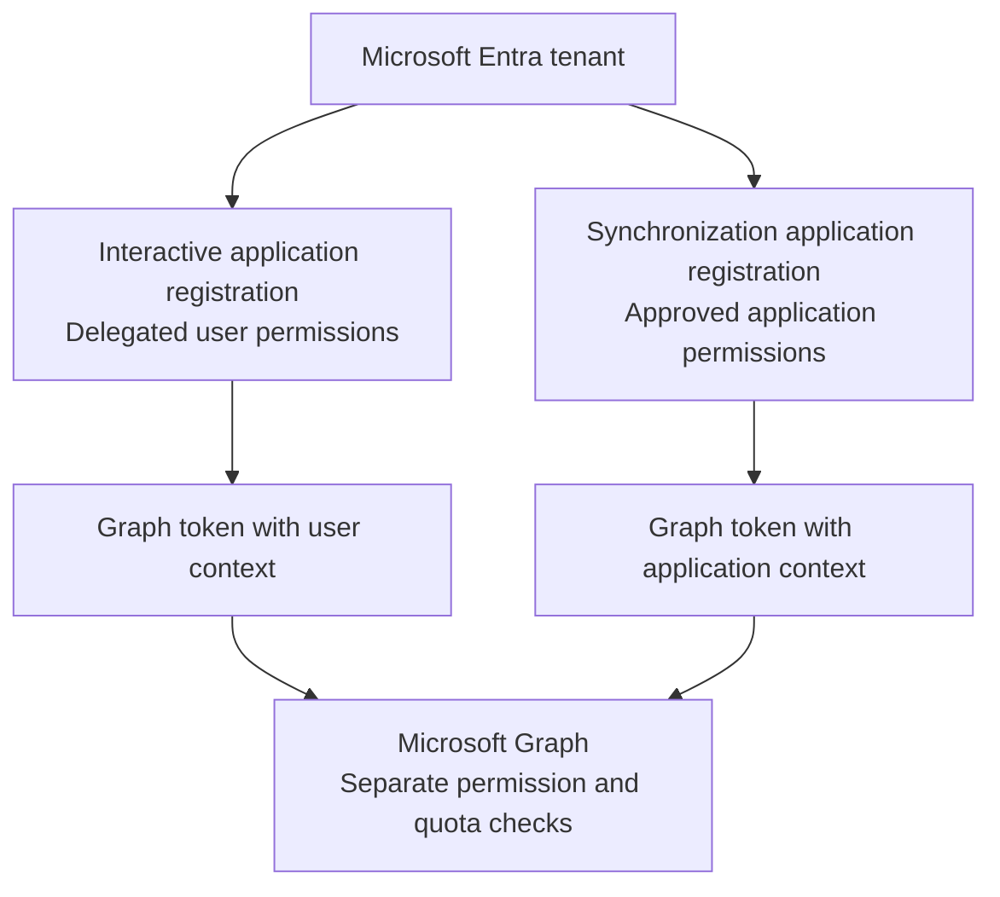

Azure workload identities and callback audiences are an additional plane. An Azure RBAC role, a Graph permission, an application's own authorization decision, and a Web PubSub client capability are not interchangeable.

### 3.2 Registrations, principals, and roles

Names are logical identifiers. Provision separate identities and credentials per environment.

| Identity | Kind | Purpose and allowed scope |
| --- | --- | --- |
| `app-web` | Confidential, single-tenant app registration | OIDC sign-in and delegated Graph calls; registered **Web** callback URI, not a browser-held client credential |
| `app-sync` | Confidential app registration/service principal | Unattended Graph subscriptions, permitted hydration, and reconciliation; no normal user-authored sending |
| `app-events-api` | Callback API registration | Audience and application-role boundary for authenticated Web PubSub upstream requests; no Graph permission required |
| `mi-api` | User-assigned managed identity | Approved Cosmos/session/cache access, credential retrieval, and Web PubSub negotiation |
| `mi-callbacks` | User-assigned managed identity | Notification queue send, admission authority/connection-plan access, and minimal configuration; no broad message-projection writes |
| `mi-projector` | User-assigned managed identity | Notification receive, projection/outbox writes, cache invalidation, approved decryption access |
| `mi-delivery` | User-assigned managed identity | Outbox/delivery work, required entitlement reads, and Web PubSub publish/group/connection control |
| `mi-control` | User-assigned managed identity | Control/repair data, `app-sync` credential access, subscription coordination, and approved lifecycle ingestion |
| `mi-pubsub` | Web PubSub resource identity | Calls the upstream handler using the explicit `app-events-api` audience |
| Deployment principal | Federated CI/CD principal | Environment-scoped deployment permissions; no routine business-data access |

Use managed identities for Azure resource access. Graph application access for `app-sync` is separately consented and acquired through its configured confidential-client credential. Assigning an Azure identity to a workload does not grant Graph roles.

Prefer certificate credentials or a supported workload-federation configuration over long-lived shared client secrets. The selected credential mechanism is an implementation/deployment choice, not an assertion that any managed-identity token can be exchanged arbitrarily.

### 3.3 Baseline authentication: cookie BFF

The proposed browser baseline is a backend-for-frontend:

1. The server uses OIDC authorization code flow with PKCE through a supported library [A1].
2. The callback validates state, nonce, issuer, audience, tenant, and protocol correlation.
3. The confidential backend redeems the code and maintains the MSAL token cache.
4. The browser receives an opaque, secure application session cookie, not Graph or Entra access/refresh tokens.
5. The backend acquires delegated Graph tokens from its user token cache only when a Graph operation needs them.

A cookie-authenticated BFF can call Graph using authorization-code-acquired delegated tokens. It does **not** need to invent an OBO assertion from a cookie or ID token.

Use HTTPS-only, HttpOnly cookies with an approved SameSite policy, constrained path/domain, idle/absolute expiry, and CSRF protection for mutations. Handle OIDC correlation cookies and response mode through the authentication library. Trust forwarded headers only from the configured proxy path and fix the canonical external callback hostname.

Replicas need a consistent protected session/key-ring strategy. Do not use an unshared, ephemeral per-replica signing/encryption key. Session loss can require sign-in again; it cannot authorize a fallback session.

An application session is not an everlasting delegation grant. If silent token acquisition requires interaction or a claims challenge, return an explicit reauthentication state. Do not replace the user with `app-sync`.

### 3.4 Optional bearer API and OBO variant

If a future SPA/native client holds an access token for this application's API, the middle tier may use OBO to acquire a delegated Graph token [A2]. That requires an explicit API audience, scopes/consent, token validation, and a confidential middle tier.

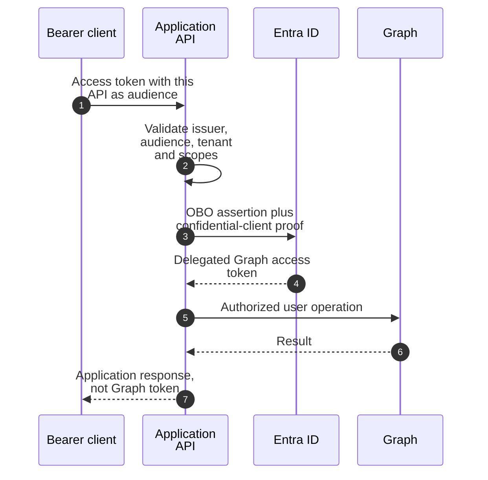

Do not accept a Graph-audience access token as an assertion for an unrelated API. Do not use an app-only token, session cookie, or ID token as the OBO user assertion. This variant is not silently combined with the cookie-BFF baseline.

### 3.5 Permission and data-access matrix

| Operation | Identity/context | Permission/control |
| --- | --- | --- |
| Sign in and maintain session | `app-web`, user | OIDC scopes; approved sign-in/assignment/Conditional Access policies |
| Send chat/channel message | `app-web`, delegated | Documented `ChatMessage.Send` / `ChannelMessage.Send`, membership and application policy checks |
| Delegated history/control calls, if selected | `app-web`, delegated | Exact endpoint-specific read permissions; do not add a broad scope preemptively |
| Rich notification subscription/hydration | `app-sync`, application | Narrowest documented resource/RSC/installed scope; approved broader scope only when necessary |
| Membership/history synchronization | Approved control identity | Separately verified endpoint permission and bounded authority; message permission alone is not assumed sufficient |
| Cosmos data | Workload managed identity | Container/resource-scoped data-plane role; ARM Contributor is not a substitute |
| Service Bus | Workload managed identity | Data Sender/Data Receiver at the required entity scope |
| Managed Redis | Approved workload principal | Entra cache authorization, TLS, token refresh, and supported key/command restrictions |
| Web PubSub backend | `mi-api` / `mi-delivery` | Resource-scoped Web PubSub Service Owner or validated narrower custom role [A8] |
| PubSub upstream callback | `mi-pubsub` | Explicit `app-events-api` audience and allowed application principal/role [A9] |
| Key Vault | Credential/decryption owner | Specific secret/key/certificate operations; no runtime administrator role |

Complete the deployment's endpoint/version/permission matrix before consent. Installed-to-chats scope requires the corresponding Teams app installation; the web app's Entra client ID does not create that resource boundary automatically.

Redis users/principals receive full command/key access by default in the reviewed documentation. Custom access strings are documented as preview and have limitations [A6, A7]. Do not claim key-prefix isolation from ordinary Azure RBAC. Use an approved supported ACL configuration, or separate cache resources where a required security boundary cannot rely on preview features.

Use a Redis client that refreshes Entra authentication before token expiry with jitter [A6]. Cached credentials do not mean a connection can ignore expiry indefinitely.

### 3.6 Session, entitlement, and callback safeguards

The authorization guard uses verified `tenantId` and user object identity, current application/session status, conversation membership, visible-history cutoff, content policy, and an approved freshness lease.

Define `sourceVerifiedAt`, `freshUntil`, `policyEpoch`, and revocation state. Never extend a source-verification lease merely because a cache entry was read. Unknown or expired authority produces an explicit unavailable/verification-required outcome, not access to stale copied content.

Graph membership notifications alone do not prove a bounded revocation time. The authoritative lifecycle/entitlement source and its propagation bound remain deployment acceptance decisions. If the required freshness cannot be proved within the available budget, copied-data serving does not pass security acceptance.

For Graph rich notifications, follow the resource-specific validation and application/service-principal prerequisites, including any assignment-policy interaction. For Web PubSub upstream callbacks, configure a nonempty, explicit audience for `app-events-api`, validate token signature/issuer/audience, and allow only the assigned service principal/role. Do not accept a Graph token as the callback's audience token [A9].

Graph callbacks must not be redirected to an interactive login. Separate challenge handling, payload validation, and Web PubSub service authentication by route.

### 3.7 Credential lifecycle

Keep confidential-client credentials, notification decryption keys, session/key-ring material, and transport TLS certificates separate by purpose.

Cache approved credentials/key versions in protected backend memory rather than invoking Key Vault for every message or read. If policy requires remote cryptographic operations, measure Key Vault operation quotas and latency as an additional ingestion dependency.

Rotate notification encryption certificates by activating the new public certificate/subscription configuration while retaining old private-key versions for outstanding notifications, retries, queue backlog, and approved recovery. Do not delete a key simply because a deployment now uses a newer certificate.

No tokens, client capabilities, private keys, raw notification bodies, or OAuth callback query values belong in ordinary access logs.

## 4. Software architecture

### 4.1 Interactive modules

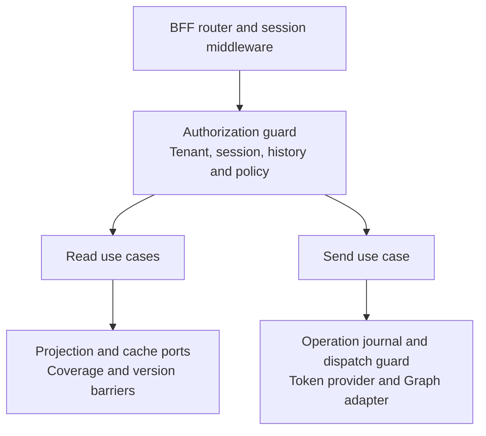

The initial API can host these modules in one deployment. In-process calls are not network microservices. If later split, propagate identity through a defined authenticated protocol; never trust an arbitrary `X-User-Id` header.

### 4.2 Background modules

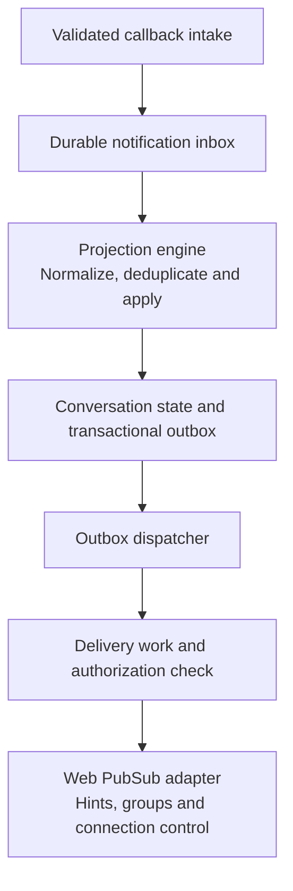

The control worker invokes the same projection engine after bounded hydration/repair. A known confirmed send also uses that engine; it does not wait for its matching external notification.

### 4.3 Responsibilities, ports, and ownership

| Module | Owns | Must not do |
| --- | --- | --- |
| Browser shell | In-memory views, pending/send states, cursor catch-up, rendering metrics | Store Graph credentials, authorize itself, or persist business content offline by default |
| Session middleware | BFF session, CSRF/correlation, token-cache handle | Treat a browser-supplied user/tenant ID as authority |
| Authorization guard | Fresh entitlement decision and action/history constraints | Convert app-only Graph consent into user access |
| Read service | Bounded pages, coverage and minimum-revision handling | Execute an unbounded Graph scan on cache miss |
| Send service | Command validation, idempotency scope, dispatch state, known confirmation | Report local acceptance as sent or replay uncertain commands |
| Projection engine | Conditional merge, normalization, tombstones, app revisions, outbox creation | Treat opaque Graph ETags as sortable versions |
| Graph adapter | Typed endpoint capabilities, auth mode, permits, deadlines, attempt telemetry | Expose a generic arbitrary-URL proxy or silently switch to app-only sending |
| Budget coordinator | App/tenant/resource/user permits, shared cooldowns, bounded reservations | Multiply capacity by replica or region count |
| Inbox consumer | Lock/renewal, processing outcome, completion/dead-letter handling | Complete work before the required durable transaction succeeds |
| Outbox dispatcher | At-least-once publication and recoverable publish state | Claim a transaction spans Cosmos and Service Bus |
| Delivery service | Current recipient/group policy, hint coalescing, connection control | Broadcast historical/blocked bodies to every conversation member |
| Subscription controller | Scope inventory, renewal, certificate IDs, callback readiness | Create a subscription per browser |
| Hydration/repair controller | Coverage, priorities, bounded pages, repair state | Bypass the shared Graph budget because a queue is long |

Ports separate business logic from Azure/Graph SDKs: `EntitlementStore`, `SessionStore`, `ProjectionRepository`, `OperationJournal`, `GraphTransport`, `GraphTokenProvider`, `BudgetStore`, `NotificationInbox`, `DeliveryOutbox`, and `RealtimeGateway`.

Keep endpoint capability metadata explicit: supported auth mode, API version, query options, paging behavior, permitted operation class, retry safety, and applicable limit scopes.

Validate an opaque Graph `nextLink` against the approved HTTPS authority/resource context, then use it unchanged. Do not reconstruct its query token or allow arbitrary user-provided URLs.

### 4.4 Concurrency and dispatch boundaries

Reads, Graph commands, notification processing, and repair need separate bounded concurrency pools. A slow Graph operation must not exhaust API execution capacity for local reads.

The budget store must coordinate all applicable scopes. Use supported atomic operations and deliberate Redis cluster key placement; a script cannot atomically update arbitrary keys in different hash slots. Reserve conservatively, release only proven unused capacity, and fail closed when permit state is uncertain.

Use conditional operation transitions to ensure one local dispatch owner per operation. An expired dispatch lease after a crash is not evidence that Graph never received the POST.

The application-global/tenant/resource budgets use the actual Graph client identity, not the Azure workload identity label. Separate legitimate permission identities are measured separately without treating them as an approved quota-avoidance strategy.

## 5. Data architecture and contracts

### 5.1 Containers and transaction scope

| Logical container | Partition / locality | Documents and consistency responsibility |
| --- | --- | --- |
| Conversation state | Full `(tenantId, conversationId)` key, using a validated partition-key design | Messages, tombstones, operation records, conversation revision, bounded change journal, outbox |
| Principal/control state | Tenant plus principal/control scope | Session/revocation authority, entitlement evidence, writer epoch, resource/subscription coverage |
| Inbox/index views | Tenant plus user or approved index scope | Conversation references, preferences, and bounded inbox views; no body copy per user |

Cosmos transactions cover operations in one container and one logical partition [A5]. The full partition key must match. Sharing a tenant or account does not make cross-container work atomic.

Colocate the confirmed operation result and its projection/outbox changes where an atomic batch is required. Use conditional ETag updates for competing writers. Index and control-state updates outside that partition are separate, recoverable operations.

A conversation revision counter/change journal simplifies bounded catch-up but is also a hot key. Measure native Teams event bursts and data size; a higher aggregate RU allocation cannot remove a logical-partition bottleneck.

### 5.2 Main records

| Record | Important fields |
| --- | --- |
| Message projection | Resource identity, parent/reply identity, sender identity, service timestamps/ETag, normalized content/policy, app revision, expiry |
| Tombstone | Resource identity, deletion/policy evidence, application revision, replay-protection retention |
| Conversation state | Current application revision, covered range, repair state, projection/schema version |
| Send operation | Actor, conversation, operation/window ID, payload fingerprint, state, writer epoch, dispatch evidence, Graph ID when known |
| Outbox item | Event ID/type/schema, conversation, revision, source, correlation, publication state |
| Entitlement | Principal/resource, membership/history constraints, policy/revocation epoch, source evidence, freshness lease |
| Coverage checkpoint | Scope/window, successful scan/checkpoint evidence, gaps, repair reason and next permitted work |
| Connection record | Service connection ID, verified principal/session, authorization lease, server-selected groups, lifecycle state |

Use valid, canonical document identifiers derived from resource identity. Preserve reply/resource context rather than assuming a message ID alone is globally unique.

`appRevision` orders this projection's changes; it is not a Graph sequence number. Graph timestamps and opaque ETags are evidence for merge decisions, not a guaranteed total order. On conflicting or insufficient evidence, mark repair and perform a budgeted authoritative check.

### 5.3 Operation and consistency rules

| State / transition | Rule |
| --- | --- |
| New to pending | Validate actor/resource/window and conditionally create one operation record |
| Pending to dispatching | Fresh authorization, current write owner, Graph permit, and successful conditional claim |
| Dispatching to confirmed | Definitive Graph creation result; retain the Graph ID |
| Pending/dispatching to rejected | Definitive non-commit evidence only |
| Dispatching to unknown | Commitment cannot be proved after timeout, disconnect, crash, or state recovery |
| Unknown to confirmed/rejected | Exact trustworthy evidence, not body/time similarity alone |
| Projection pending | Independent synchronization state; it does not erase known Graph confirmation |

A same-key replay returns the recorded result/state; a changed payload under the same key is a conflict. A duplicate Graph notification must not increment app revision or emit another material-change event merely because it arrived twice.

Use a bounded, server-issued command window, returned with an authorized conversation view. Bind it to tenant, actor/session, conversation, writer epoch, and expiry. The browser generates an operation ID within that window. Journal retention must outlast every valid window and the approved retry/recovery interval.

Reject expired or invalid command windows instead of treating a reclaimed operation key as proof of a new safe send. Status lookup can remain available after dispatch permission expires. The UI must never convert an unknown operation into a new send automatically.

For read-your-writes and hint-driven refresh, the read service enforces a minimum application revision. Use a suitable database consistency/session-token or read-barrier strategy across SDK instances and regions; an app revision number alone does not strengthen Cosmos consistency. If the required state is not available before the deadline, return a retry/coverage state rather than an older page labeled current.

### 5.4 Cache and messaging contracts

| Cache family | Scope | Safety rule |
| --- | --- | --- |
| Recent message view | Tenant/conversation/schema/revision | Shared payload is filtered by user history/policy before response |
| Entitlement lease | Tenant/principal/resource/policy epoch | Expiry is bounded by verified source evidence; not renewed on cache reads |
| Session/token-cache reference | Tenant/principal/application/session | Protected backend storage; cache loss requires supported refresh or sign-in |
| Graph permit state | Actual client identity plus applicable limit scopes | Coordinated scopes and cooldown; unknown state cannot grant unlimited capacity |
| Hydration single-flight | Tenant/resource/window | Bounded lease; one queue job does not prove successful coverage |

The durable outbox carries a versioned internal event, for example:

```json
{
  "schemaVersion": 1,
  "eventId": "<opaque-event-id>",
  "type": "conversation.projection.changed",
  "tenantId": "<tenant-id>",
  "conversationId": "<conversation-id>",
  "appRevision": 42,
  "source": "graph-notification",
  "correlationId": "<correlation-id>"
}
```

Inbound notification envelopes retain the approved encrypted payload, subscription/certificate references, validated resource metadata, received time, and correlation. A delivery GUID identifies receipt, not semantic uniqueness. Do not deduplicate all updates using resource ID alone.

The proposed safe default for client real-time delivery is an authorized, coalesced change hint with an opaque catch-up token, not a message-body broadcast. Bodies are fetched through the read guard. This limits historical/DLP exposure from group delivery but does not replace current membership checks.

Body-bearing push is an optional refinement only for verified policy/history cohorts. Membership in a conversation does not grant every member visibility of every historical message or edit. Group authorization must account for that distinction.

Hints create application read traffic. Include those reads, catch-up, and negotiation work in the TDD workload mix before claiming the API envelope passes; notification-driven reads are not free.

### 5.5 Proposed application API

Routes describe contracts to implement, not existing endpoints. Use application-owned handles/cursors; Graph resource paths and database continuation tokens are not public API contracts.

| Route | Purpose / principal response |
| --- | --- |
| `GET /auth/signin`, `/auth/callback` | Library-managed OIDC flow; no Graph tokens returned to JavaScript |
| `POST /auth/signout` | Invalidate session and related connection permissions |
| `GET /api/conversations` | Bounded authorized inbox/feed references and coverage |
| `GET /api/conversations/{id}/messages` | Authorized initial/recent page, opaque cursor, coverage, command window |
| `GET /api/conversations/{id}/changes` | Bounded authorized catch-up from a signed application change token |
| `POST /api/conversations/{id}/messages` | Operation ID/window plus validated body; known Graph creation returns `201` |
| `GET /api/conversations/{id}/operations/{operationId}` | Actor-authorized pending/confirmed/rejected/unknown state |
| `POST /api/realtime/negotiate` | CSRF-protected negotiation; no-store client capability response |
| `POST /callbacks/graph/messages`, `/callbacks/graph/lifecycle` | Resource/lifecycle validation and acceptance |
| `/callbacks/pubsub` | Supported Web PubSub upstream protocol with service authentication |

Use explicit typed errors: `authentication_required`, `access_denied`, `access_verification_unavailable`, `projection_preparing`, `graph_capacity_exceeded`, `operation_unknown`, and `idempotency_conflict`.

`202` can describe an existing pending/unknown operation or preparing projection, but does not satisfy usable-content or confirmed-send SLOs. `429` before dispatch communicates known capacity rejection and retry guidance. A same-operation replay does not resend; a deliberate new attempt after a definitive rejection uses the documented new-operation policy.

An uncertain or failed authorization check is not a fabricated empty list. Missing resources/access failures must not reveal another user's operation or resource existence.

### 5.6 Privacy and storage options

This catalog covers the practical architecture families and their meaningful storage variants. It is not an exhaustive list of database products, nor a statement that every option satisfies the reference requirements.

**Personal data includes more than message bodies:** identities, membership, resource IDs, timestamps, previews, operation records, and linkable fingerprints can also be personal data. A cache is still a place where personal data is processed/stored. Encryption and pseudonymization do not automatically make a copy anonymous.

| ID / option | Message-content handling | Read performance and resilience | Privacy requirement and main trade-off |
| --- | --- | --- | --- |
| **P01: Browser directly to Graph** | Message bodies travel between the browser and Graph, not through the Azure application backend; only separately approved metadata goes to backend services | No application-owned body cache; Graph latency, paging, and endpoint ceilings remain on the content path | Best fit when backend content processing is prohibited. Requires an approved browser delegated-auth design, no payload telemetry/offline persistence, and acceptance of a changed BFF/token boundary |
| **P02: Stateless BFF/Graph proxy** | Backend handles bodies transiently for a request but retains no message bodies in a database, queue, outbox, log, or cache | Preserves a centralized API/auth boundary, but does not isolate reads from Graph latency/throttling | Fits a ban on extra durable content copies only if transient Azure processing is permitted; not suitable for a ban on backend plaintext processing |
| **P03: Metadata-only Cosmos index** | Cosmos holds approved conversation references, permissions/coverage, and other metadata; full content comes from Graph, directly or through P02 | Faster inbox/navigation metadata; opening messages still depends on Graph. Body-bearing previews are not metadata-only | Smaller content footprint, not zero PII. Requires precise field approval and careful notification/journal handling |
| **P04: Per-replica ephemeral cache** | Short-lived bodies in application-process RAM only; no deliberate durable body persistence | Fast repeat reads on that replica; lower sharing, duplicated hot sets, cache-miss amplification, and loss on restart/scale-out | Requires explicit approval for RAM copies and verified handling of dumps, diagnostics, and process lifecycle; transient does not mean unregulated |
| **P05: Shared memory-only Redis cache** | Short-lived bodies in an approved Redis configuration; no Cosmos body projection and no durable content-bearing queue/outbox | Better shared hit rate/coalescing than P04; cold start, failover, expiry, and repair still consume Graph capacity | Verify the selected tier/configuration: persistence, snapshots/backups, flash use, replication, and expiry. Do not assume any managed cache automatically meets a memory-only policy |
| **P06: Minimized Cosmos projection** | Retain only approved fields, limited previews, or redacted/structured content for a bounded window | Fast views for retained fields; omitted/full content still requires Graph. A preview is not equivalent to the full-message experience | Reduces data volume, not necessarily identifiability. Automatic PII redaction in free text is imperfect; HTML sanitization is not PII removal |
| **P07: Bounded full Cosmos projection + Redis (proposed reference)** | Full recent message bodies for approved resources in Cosmos; Redis hot views and approved durable synchronization records; Teams remains authoritative | Strongest read-path isolation from Graph among the original reference patterns; supports replay and recovery. SLOs remain unverified targets | Adds a second personal-data store and governance workload: copied-data authorization, retention, deletion, DLP/history controls, regions, backups, and queue/outbox policies |
| **P08: Application-layer encrypted Cosmos projection** | Selected properties encrypted before database submission; an approved application/SDK decrypts them when needed | Can retain projection-based reads, with crypto/key-access overhead and restrictions on querying encrypted properties | Useful when the database service must not see plaintext, but still stores personal data. If the Azure backend decrypts, it still processes plaintext. This is different from ordinary encryption at rest and requires SDK/key-policy validation [A11, A12] |
| **P09: Resource/classification-based hybrid** | Approved resources use P06/P07/P08; other conversations use a no-copy path. Retention and fields can differ by approved class | Fast reads only for approved projected content; other resources retain Graph dependency. Needs separate workload/SLO populations | Often a useful compromise. Use explicit resource/policy approval and no-store behavior for unknown classification; a channel label alone does not prove its text contains no PII |
| **P10: Another approved Azure read store** | Replace Cosmos with an approved SQL/PostgreSQL, persistent cache, object/index store, or equivalent; retain comparable content | A suitable read model can still isolate reads; transactions, indexing, recovery, and throughput need redesign/validation | Relevant if a specific product is disallowed or another is already approved. A different database does not remove the duplicate-data problem or reduce it automatically |
| **P11: Approved private/on-premises read model** | Put the copied working set in an explicitly approved non-Azure environment and connect through approved paths | Can support custom views, but introduces hybrid latency, connectivity, availability, operational, and recovery constraints | May address a hosting restriction, not a ban on extra copies. An Azure BFF may still process bodies; no-Azure-processing policies need a different content path too |
| **P12: Native Teams conversation experience** | Use the custom app as an entry point; render conversations in the supported Teams experience without an application-owned body replica | Avoids the custom Graph read/projection pipeline; trades away control over the fully embedded custom UX and its measurements | Reduces application-owned copies. Microsoft 365 licensing, client/device storage, downloads, screenshots, and organizational policy still apply |
| **P13: Different supported chat backend** | Replace Teams as the message system of record with an approved communication service/platform; do not assume synchronization back to Teams | Different capacity, delivery, retention, and feature limits; requires its own validation rather than inheriting this TDD's results | A product/platform change, not a privacy exemption or drop-in Teams conversation store. Personal data still exists in the selected platform; assess lifecycle, identity, interoperability, and compliance |

No Teams-backed read-storage option increases the normal Graph user-authored write ceilings. None of these rows is a legal/privacy approval or proof of the 200,000-user envelope.

**Service lifecycle correction:** Azure Communication Services Chat is not recommended here for a new long-term standalone implementation. Microsoft lists ACS Chat, including Chat for Teams Meeting Interop, for retirement on **2028-09-30** [A13]. P13 means a currently supported, approved platform selected after lifecycle review; it is not an endorsement of the earlier ACS example.

#### Protection controls that can complement an option

| Control | What it helps with | What it does not establish |
| --- | --- | --- |
| TLS and platform encryption at rest | Network/media protection; Cosmos encryption at rest is enabled by default [A11] | No additional copy, no plaintext in the application, or anonymous data |
| Customer-managed storage keys | Key-control and access-governance requirements | Participant-only encryption or an exemption from approval to retain content |
| Application/SDK encryption | Separates database access from access to selected plaintext properties [A12] | No Azure plaintext processing if the Azure application decrypts; unrestricted encrypted-field queries |
| Pseudonymization and redaction | Reduces unnecessary identifiers/content when correctly designed | Guaranteed anonymization of free-form text or elimination of linkability |
| Approved regions/private endpoints/least privilege | Residency, exposure, and access boundaries | Permission to make a copy that policy otherwise prohibits |
| Bounded retention, purge, and auditable deletion | Limits exposure duration and supports lifecycle obligations | Immediate removal from every queue, backup, diagnostic export, or previously viewed device |
| Confidential runtime/key separation, where approved | Additional processing/key-access protections for a defined threat model | A change to whether message content is stored/processed or a substitute for privacy approval |

Cosmos client-side encryption occurs in the SDK/application client, which may be the Azure backend; "client-side" does not necessarily mean the user's browser. Encrypted-field query behavior depends on the selected encryption mode, and encrypted indexes/metadata still require review [A12].

Custom participant-only message encryption is not treated as a transparent option for this Teams reference. It would change message interoperability, rendering, search, DLP, and compliance behavior and needs a separate supported product/protocol design.

### 5.7 Selecting and implementing a privacy boundary

Start with the actual policy boundary, not a database preference:

| Policy boundary | Options to investigate first | Required qualification |
| --- | --- | --- |
| No extra durable message bodies outside Microsoft 365; transient backend processing allowed | P01-P03; P04/P05 only if RAM caching is explicitly allowed | No content-bearing durable synchronization, diagnostics, outbox, or operation records; metadata still needs approval |
| No message bodies processed by the Azure application backend | P01 or P12 | No BFF body proxy, backend decryption/redaction, or body-bearing callback processing; approve remaining identity/metadata separately |
| Only approved fields or resources may be retained | P06 or P09 | Validate the allowlist/classification, default no-store behavior, residual PII, retention, and profile-specific UX |
| Cosmos service must not see selected plaintext properties, but approved application processing is allowed | P08 | Client-side encryption/key-policy/SDK review; do not confuse this with a ban on all Azure plaintext processing |
| A specific Azure store is disallowed or storage must stay in approved infrastructure | P10 or P11 | Confirm whether the restriction concerns the product, hosting location, processing path, or every additional copy |
| A governed bounded content copy is permitted | P07, possibly combined with P08/P09 | Explicit privacy/security approval and evidence for copied-data authorization, retention/deletion, synchronization, performance, and recovery |

A statement such as "no PII outside Microsoft 365" is stricter than "no message-body database." None of the options automatically eliminates personal identifiers from Entra/application sessions, entitlement data, metadata queues, or access logs.

Changing from P07 affects the complete data flow:

1. **Inventory every copy.** Include Cosmos, Redis, inbox/DLQ, outbox, operation evidence, backups, crash dumps, traces, support exports, and browser storage. Encrypted rich notifications are still content copies.
2. **Change notification acceptance.** For a no-durable-body design, use basic notifications or an explicitly approved transient extraction path, and persist only approved metadata. Follow-up GETs consume Graph budget; do not leave the original encrypted-content queue unchanged.
3. **Change write evidence and delivery.** Keep only approved operation outcomes/identifiers/fingerprints and metadata-only outbox events. Do not reintroduce bodies through durable command journaling or a failed-work queue.
4. **Change authentication when necessary.** P01 requires an approved browser-to-Graph delegated flow. Do not implement it by returning BFF-owned Graph tokens to JavaScript or silently treating it as the existing cookie-BFF path.
5. **Recalculate capacity and SLOs.** Body reads, misses, restarts, expiry, and native Teams changes can create new Graph demand. The current recent-read targets cannot be transferred unchanged to a no-projection variant. Hybrid profiles need separate measurement populations.
6. **Record the selection.** Accept the processing/storage boundary, purpose, fields, resources, regions, retention, access controls, deletion/backup behavior, and support model. Do not assume Microsoft 365 DLP, retention, legal-hold, or eDiscovery behavior is inherited by a new copy.

P07 remains the proposed reference, subject to approval; this comparison does not change [ADR 0001](adr/0001-teams-system-of-record-and-bounded-read-model.md) automatically. Selecting another architecture requires an ADR and corresponding flow, contract, and acceptance-test changes. These alternatives are not runtime feature flags to enable without review.

## 6. Main interaction flows

Each flow describes its purpose, trigger, and expected outcome, then identifies components, preconditions, ordering, and failure/telemetry requirements. Shared guards include tenant isolation, session validity, policy freshness, bounded work, and redacted trace correlation.

### 6.1 F01: Sign in and acquire delegated tokens

**Description:** This flow establishes an application session when a user starts sign-in. The BFF redirects the browser to Entra, validates the returning authorization response, and redeems the code on the server to obtain tokens for the signed-in user. After checking application access, it stores the protected session and token cache and returns only an opaque session cookie to the browser. Subsequent user-initiated Graph operations acquire delegated tokens through the BFF without exposing them to browser code.

**Components:** browser, BFF, Entra, protected session/token storage. **Preconditions:** approved tenant/consent, registered Web callback, callback hostname and credential configuration.

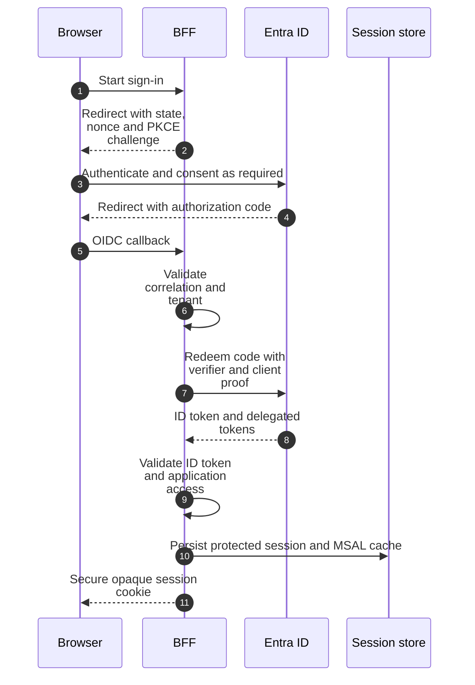

The BFF validates application access before establishing the session. Later Graph calls use supported silent acquisition; a claims/interaction requirement returns a reauthentication action, not app-only fallback.

**Failure/telemetry:** callback correlation/tenant failure denies sign-in; token/session-store failures are explicit. Measure sign-in separately from already-authenticated read SLOs and redact code/token/cookie values.

### 6.2 F02: Read recent content, including cache miss

**Description:** This flow serves a recent-message page or bounded change request from the application projection rather than querying Graph synchronously. The read API checks the user's access and looks for a suitable cached view; a cache miss or insufficient revision falls back to a bounded Cosmos query. The response contains only authorized content with its cursor and coverage evidence. If coverage or authorization cannot be established, the API returns an explicit preparing or verification state instead of presenting incomplete or unverifiable content as current.

**Components:** browser, read API, authorization guard, Redis, Cosmos. **Preconditions:** authenticated user, verified resource entitlement, defined projection window.

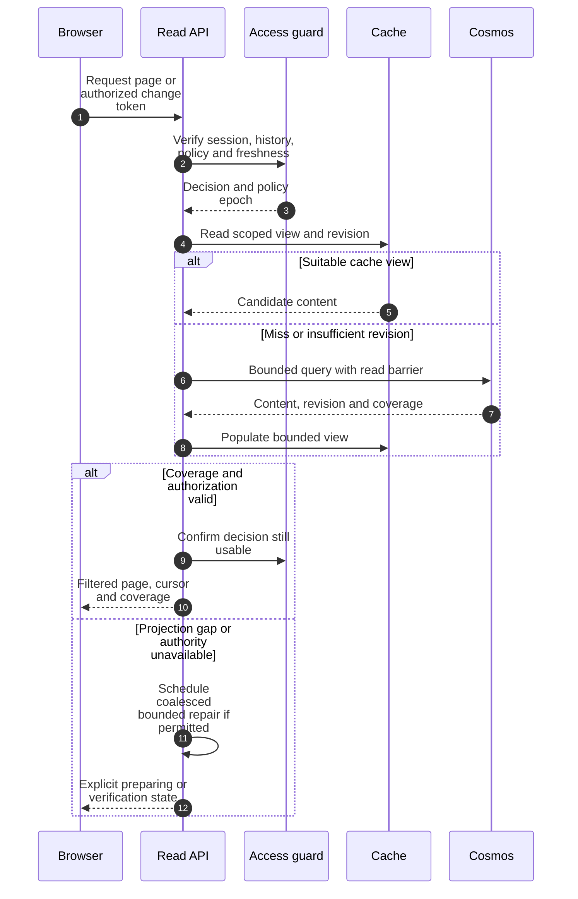

There is no synchronous Graph read in this recent-content path. Older history uses an explicitly separate, budgeted request/job; missing history does not authorize bypassing the projection guard.

**Failure/telemetry:** distinguish cache miss, insufficient revision, incomplete coverage, and unavailable authority. Count normal recent-page gaps/failures in the TDD population, and record usable rendering rather than skeleton time.

### 6.3 F03: Send a message with known confirmation

**Description:** This flow handles a user sending a message and receiving a definitive Graph creation response. The send API records the operation before dispatch, obtains shared Graph capacity, and verifies current authority and the delegated token before posting. A successful response supplies the Graph message ID, which is linked to the operation, projection, and outbox. The browser receives the known confirmation and projection status; repeating the same operation returns its recorded state without sending another message.

**Components:** browser, send API, operation/projection store, shared budget, Graph. **Preconditions:** valid command window, eligible user/conversation, delegated token, current write owner.

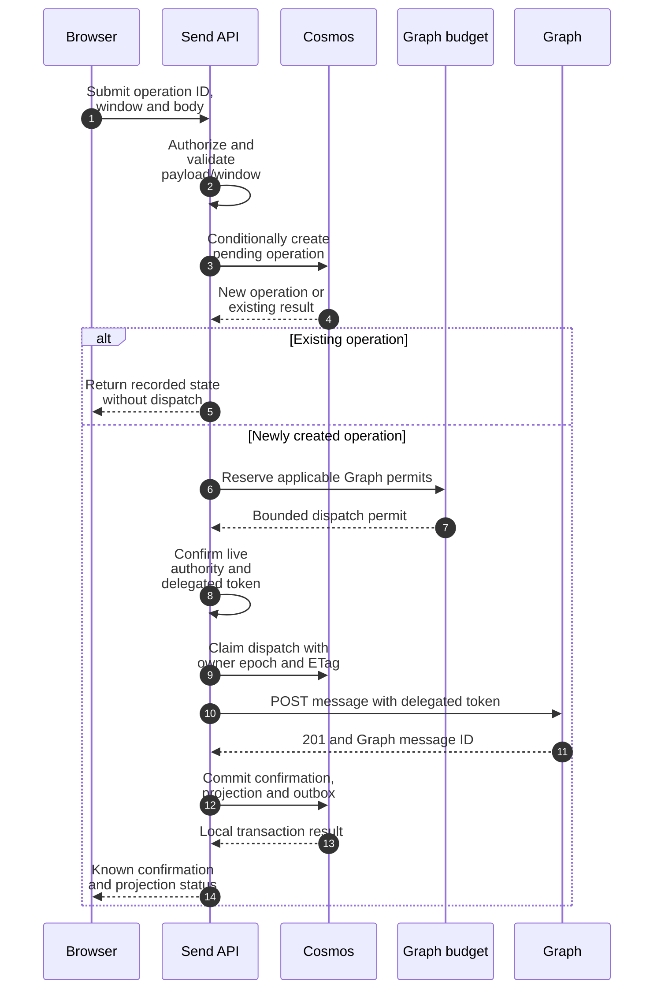

The projection engine preserves a newer edit/tombstone if a notification already arrived before the POST response. It links the confirmed operation to the known Graph ID without overwriting newer content.

If the local post-confirmation transaction fails, never repeat the Graph POST. Return the known Graph ID and explicit projection-pending state when possible, alert, and repair the durable dispatch record. If the response is also lost, the caller may still see an unknown outcome.

**Failure/telemetry:** a denied permit or definitive rejection is explicit; same-key replays return existing state. Measure complete submission-to-confirmation and separately track local confirmation persistence, projection, and delivery.

### 6.4 F04: Uncertain send and safe repeat submission

**Description:** This flow handles a send whose Graph response is lost or times out after dispatch, so the application cannot tell whether the message was created. The operation remains unknown or dispatching, and repeat submissions or status queries use the original operation record without issuing another POST. A repair worker may resolve the outcome using an exact, trustworthy resource reference and authoritative verification; without sufficient evidence, uncertainty remains visible rather than risking a duplicate message.

**Components:** browser, send API, operation journal, Graph, repair worker. **Preconditions:** dispatch was claimed; a transport/process failure prevents a definitive result.

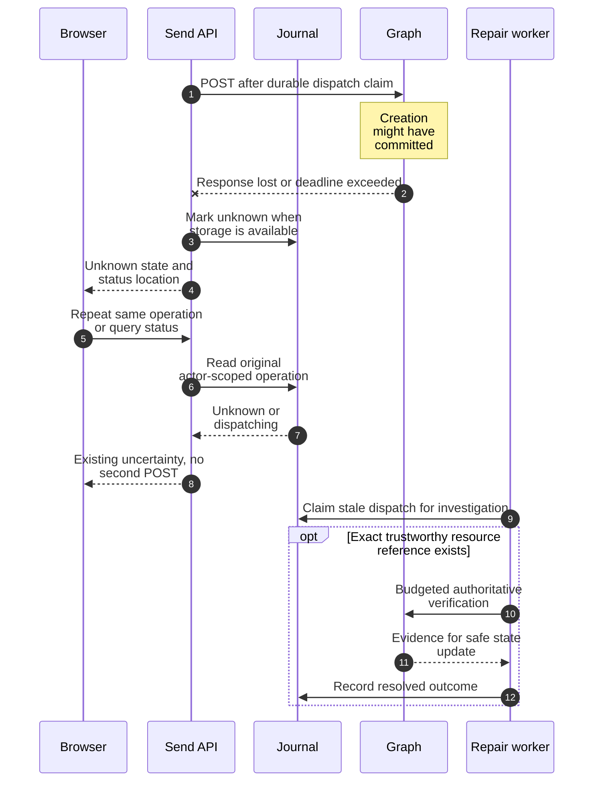

If journal writing fails after dispatch, the already-persisted dispatching record is treated conservatively during recovery. Similar body text, sender, or timestamp alone does not prove which operation created a message.

**Failure/telemetry:** unresolved outcomes remain visible and count against send success until the target is satisfied. Do not silently create a new operation after token refresh, lease expiry, region change, or journal retention.

### 6.5 F05: Accept and apply a rich change notification

**Description:** This flow brings changes reported by Graph into the local projection. The callback receiver validates the incoming notification collection and durably queues approved encrypted envelopes before acknowledging acceptance. A projector then decrypts and normalizes each notification and conditionally applies its content or tombstone, projection revision, and outbox event. Queue work completes only after a durable apply or verified duplicate, while processing failures remain retryable or are dead-lettered for investigation.

**Components:** Graph, callback receiver, notification queue, projector, Cosmos. **Preconditions:** approved active subscription, validation configuration, required key versions, queue availability.

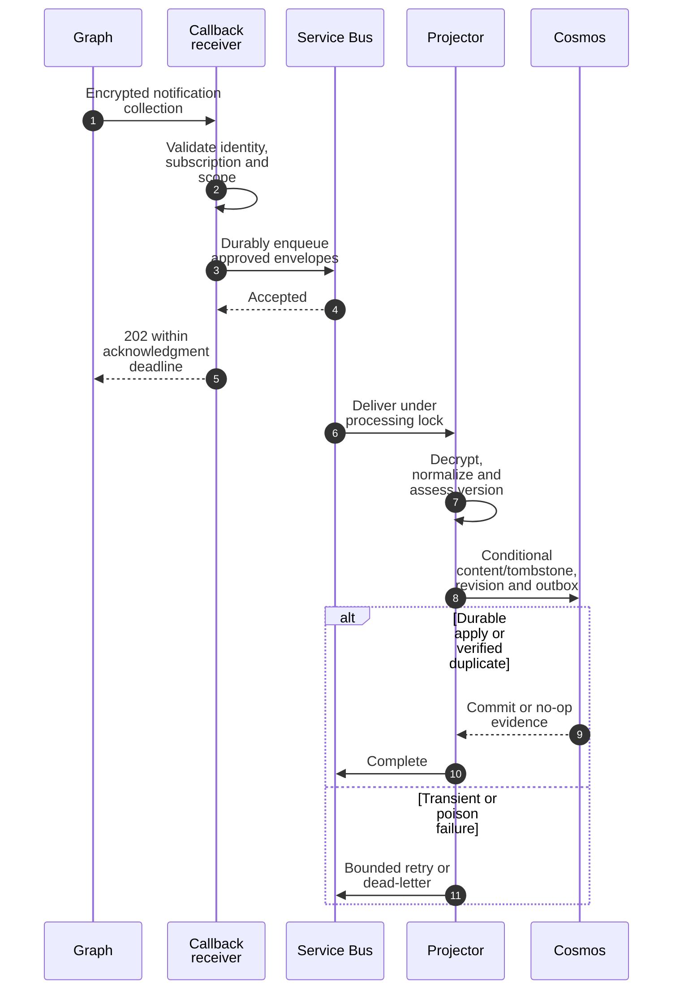

Subscription challenge validation is a separate protocol branch: echo the documented validation token as plain text with the required status/content type; do not require a user session or enqueue the challenge.

Validate each item in a collection. Acknowledge only after all valid in-scope items that require processing have durable acceptance. A partial enqueue failure causes retry and therefore duplicates; semantic deduplication must remain correct. Authenticated out-of-purpose resources follow the approved discard policy, not durable content replication.

**Failure/telemetry:** acceptance failure is non-success, not `202`. Record acknowledgment latency, validation failures, event age, processing attempts, certificate identity, projection lag, and dead-letter age without routine payload logging.

### 6.6 F06: Publish an outbox change and refresh a client

**Description:** This flow makes a committed projection change visible to connected, authorized clients. The outbox worker invalidates stale cache state or advances a read barrier, publishes a stable event to the delivery queue, and records publication progress. The delivery service rechecks recipient policy and sends a coalesced change hint through Web PubSub. The browser uses that hint to fetch authorized changes through F02; acceptance by the messaging services alone does not mean the user has seen the updated content.

**Components:** outbox dispatcher, Cosmos, delivery queue, delivery service, Web PubSub, browser. **Preconditions:** committed projection event and current recipient authority.

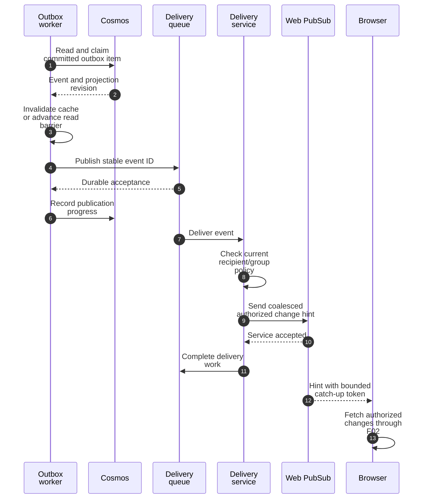

A crash after queue acceptance but before marking publication can produce a duplicate. Delivery and client application of revisions are idempotent; Service Bus duplicate detection is not the only correctness mechanism.

The delivery worker does not hold a queue lock while waiting for browser rendering. Service acceptance and client display are separate observations.

Cache invalidation is not atomic with Cosmos. Version/read barriers prevent a newly notified client from being served an older cached page labeled current. Failed invalidation is monitored and repaired.

**Failure/telemetry:** recheck eligibility after delayed queue processing; removed users must not receive body-bearing updates. Measure client content display after any follow-up read, not only publish acceptance.

### 6.7 F07: Bootstrap, renewal, and gap reconciliation

**Description:** This flow establishes and maintains synchronization for an approved resource scope, starting at bootstrap and continuing through subscription renewal and gap repair. The controller creates the subscription and buffers incoming changes while workers hydrate the bounded working set under the shared Graph budget. Snapshot pages and notifications use the same version-aware merge rules, and readiness reflects demonstrated coverage rather than simply finishing a scan. Renewals preserve change delivery, while failures or incomplete coverage trigger bounded reconciliation.

**Components:** subscription controller, Graph, callback receiver, queue, hydration worker, Cosmos. **Preconditions:** approved scope/permissions, working callbacks, retained keys, and reserved Graph budget.

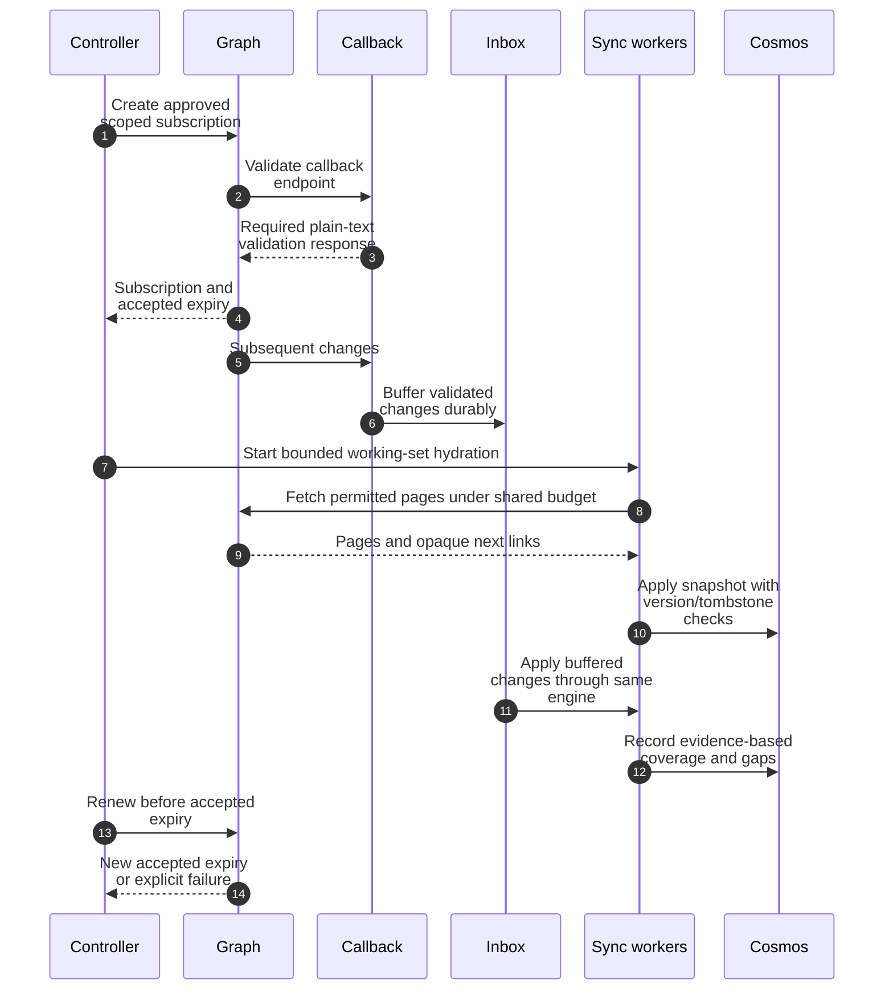

The sync-workers lane combines the separately scheduled hydration and notification-consumer paths for readability; it does not merge their deployment identities or queue ownership. They share merge logic but retain separate scheduling/budgets. If processing is concurrent, conditional merges preserve changes; a snapshot is not assumed to be an atomic tenant-wide point in time.

Mark ready only for demonstrated resource/window coverage. Page/time-budget exhaustion records partial coverage and follow-up work. Renewal failure/removal triggers repair; do not wait for a universal `missed` event or assume every selected resource supports delta.

**Failure/telemetry:** monitor coverage age, oldest buffered change, successful renewal margin, credential/key rotation, repair backlog, and Graph budget consumption. No unbounded catch-up scan is allowed on the interactive read path.

### 6.8 F08: Revoke access and close connections

**Description:** This flow withdraws application access after a verified offboarding or resource-access change. The control worker durably records the denial or policy change together with connection-control work, then invalidates affected authorization leases, sessions, or command windows as appropriate. A dispatcher removes affected Web PubSub group memberships or closes connections and retries unresolved control actions. API access is governed by the updated authority independently of when socket closure finishes.

**Components:** approved lifecycle source, control worker, entitlement/session authority, connection-control adapter, Web PubSub. **Preconditions:** authenticated source with a defined propagation guarantee.

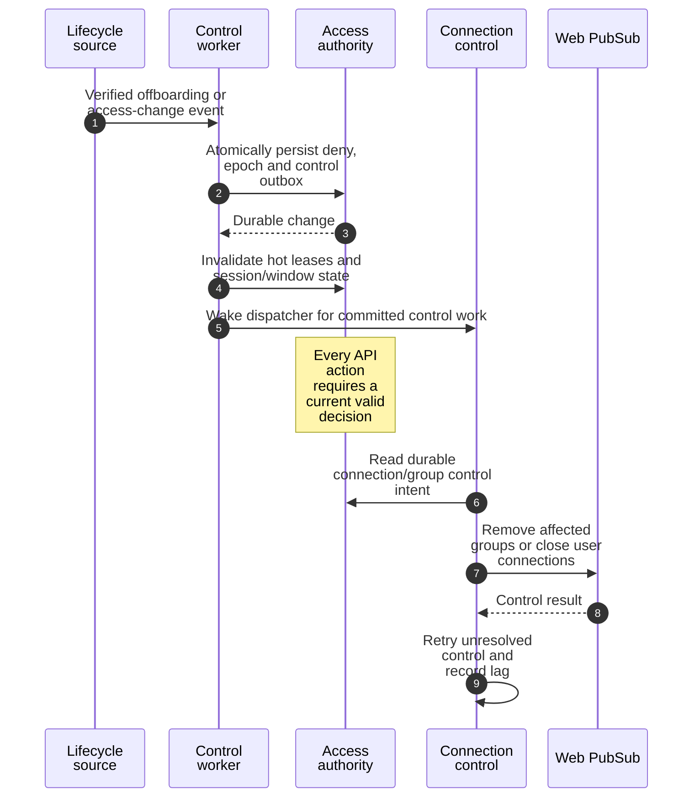

For offboarding, invalidate all affected application sessions, command windows, and connection permissions. For conversation/history changes, constrain the affected resource and invalidate corresponding cached views/decisions.

Colocate denial and its connection-control outbox in the same control partition. Dispatcher wake-up is only an optimization; committed control work remains discoverable after a worker crash.

A short-lived Web PubSub token alone is not ongoing revocation. Check current authority on upstream connection admission as well as negotiation, so a previously issued token cannot bypass a known denial. Configure the upstream handler to reject on authorization failure/unavailability.

**Failure/telemetry:** durable denial and API enforcement are independent of eventual socket closure. Preserve retryable control work, expire unverifiable leases, and measure source delay, authority propagation, denied operations, and closure completion. Do not promise instant Teams revocation from delayed notifications.

### 6.9 F09: Reconnect and catch up

**Description:** This flow restores a browser's live updates after a connection interruption and catches up its displayed content. The client first attempts supported reliable resume; if a new connection is needed, the BFF negotiates a short-lived capability and the upstream admission handler revalidates current access and server-selected groups. The browser then requests bounded changes from its application cursor. An unusable cursor requires a fresh authorized page, not an assumption that Web PubSub retains the complete message history.

**Components:** browser, BFF, access authority, admission handler, Web PubSub, projection repository. **Preconditions:** allowed user/session and a supported reliable-client protocol.

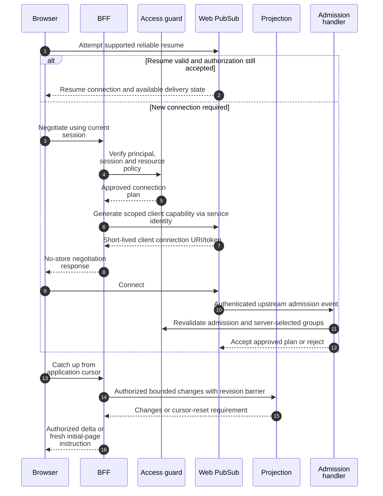

On invalid/expired cursor or lost reliable delivery state, reset through the read API. Web PubSub is not the durable message archive. Do not force a Graph hydration or interactive login for every network reconnect.

**Failure/telemetry:** jitter retries, reuse valid supported SDK resume behavior, and rate-limit negotiation. Measure backend token-generation/connect-admission throughput independently of nominal connection capacity; Entra and Web PubSub Auth APIs are not assumed unlimited.

### 6.10 F10: Regional failover

**Description:** This flow transfers serving responsibility to the recovery region when the active region must be replaced. Recovery control first fences the old write owner and verifies recovered state and ownership, then restores authorization, operation journals, and shared budget controls before routing traffic to ready capabilities. Unresolved sends remain unknown, and clients reconnect while bounded reconciliation resumes. Capabilities whose fencing, authority, or state readiness cannot be proved remain unavailable rather than accepting unsafe reads or duplicate writes.

**Components:** recovery coordinator, old write owner, durable control/data state, recovery region, Front Door. **Preconditions:** a tested fencing mechanism and accepted state-recovery evidence.

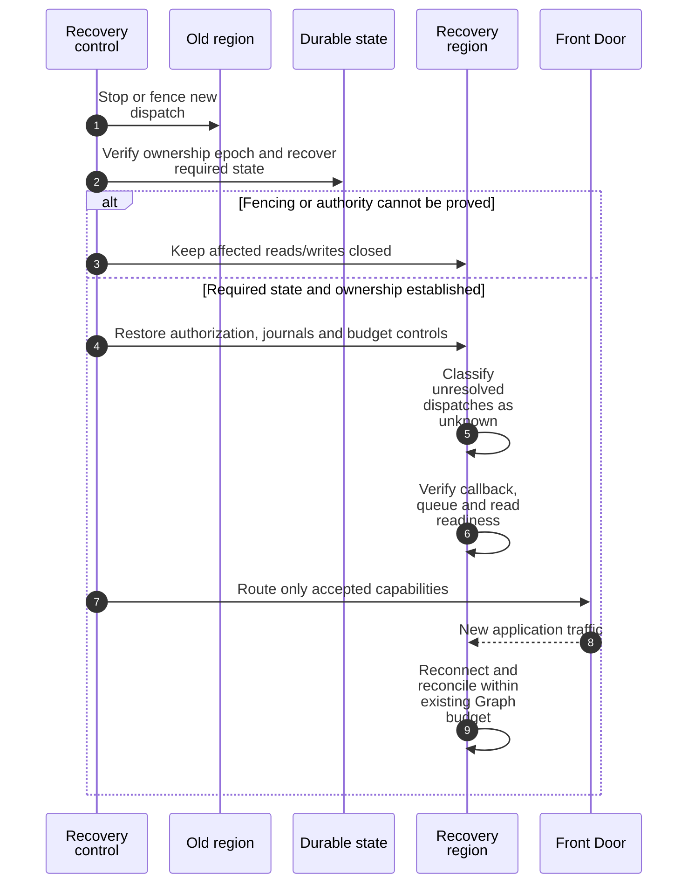

Fencing prevents new local dispatch by an old owner; it cannot cancel a Graph request already in flight. Previously dispatched operations remain conservative until definitive evidence exists.

Read readiness, write readiness, and synchronization readiness are separate. Edge health alone cannot authorize writes or certify entitlement freshness. Missing session/token-cache state can require reauthentication; do not accept stale claims to preserve availability.

**Failure/telemetry:** record ownership changes, state lag, unresolved operations, actual serving capacity, and recovery duration. Never multiply Graph budgets during transition or claim that an entire projection can be rebuilt from Graph inside the RTO without evidence.

## 7. Failure and recovery behavior

### 7.1 Recovery matrix

| Condition | Interactive behavior | Durable/background behavior |
| --- | --- | --- |
| Graph `429` | Explicit retry/capacity state; include waiting in the operation deadline | Shared cooldown and bounded rescheduling of safe operations |
| Graph latency/`503` | Keep permitted recent reads independent; no false confirmation | Read retry within budget; command replay only with proven safety |
| POST commitment uncertain | Preserve original operation and show unknown | Investigate exact evidence; never infer non-commit from timeout alone |
| Token interaction required | Reauthenticate before another eligible dispatch | Do not borrow background app-only permission |
| Redis read-view failure | Bounded Cosmos read with current authorization | Controlled refill; no Graph storm |
| Redis policy/budget uncertainty | Deny/temporarily unavailable for affected capability | Recover authority/coordination before issuing permits |
| Cosmos apply failure | Explicit coverage/projection status | Keep inbox work; retry with concurrency checks; no early completion |
| Cache stale after commit | Enforce minimum revision or explicit retry state | Retry invalidation/read-barrier update |
| Outbox publication crash | No duplicate Graph send | Republish stable event; tolerate duplicate delivery |
| Missing decryption key | No fabricated content | Refresh approved key versions; bounded retry/DLQ and alert |
| Subscription removal/expiry | Surface synchronization degradation | Renew/recreate and repair approved windows within budget |
| Queue poison/backlog | Freshness reflects actual delay | Isolated DLQ, accountable replay, payload retention policy |
| Entitlement source delayed | Do not imply newer access evidence than exists | Apply the approved freshness/fail-closed policy; security gate remains binding |
| Region loss | Capability-specific unavailability until ready | Fence, recover state, restore bounded consumption, and reconcile uncertainty |

### 7.2 Timeouts, leases, and retry invariants

Configure operation deadlines from the [TDD targets](technical-design.md#4-slis-and-proposed-slos). Reserve time for authorization, token acquisition, permit waiting, Graph, persistence, and response; do not assign every stage the full end-to-end deadline.

Graph retry middleware and application retry policy must form one controlled policy. Safe reads may retry under the shared budget. Commands require explicit evidence-based retry rules; changing the correlation header does not make a POST idempotent.

Queue lock renewal, dispatch claims, authorization leases, subscription expiry, session expiry, and command windows are different clocks. Record each explicitly. Expired leases are reasons to reassess, not proofs that an external side effect did not happen.

Use backpressure and queue-age limits. Adding projector replicas cannot solve a Graph or downstream storage ceiling. Reconciliation yields to reserved lifecycle/control work without dropping content silently.

### 7.3 Recovery consistency and retained evidence

The read-model RPO does not automatically apply to authorization or idempotency evidence. Define the acceptable loss for each state class and block affected capabilities when it is not met.

Retain operation/tombstone/outbox evidence for the approved replay horizon. Do not expire unprocessed outbox work or the only proof needed to prevent a stale replay merely because content retention is shorter. Resolve this retention interaction explicitly rather than keeping all message bodies indefinitely.

Test regional queue-data recovery. Metadata/alias failover alone does not prove the buffered notifications survived. Use approved data replication or a tested repair plan consistent with the Graph budget.

## 8. Deployment and operations

### 8.1 Environment and infrastructure layout

Use separate development, staging, load-test, and production resource/identity scopes. A separate Azure subscription does not isolate Microsoft 365 throttling if environments still use the same Graph app/tenant/resources.

| Infrastructure group | Typical resources and dependency |
| --- | --- |
| Global edge | DNS, Front Door/WAF, routes, certificates, regional origin groups |
| Regional platform | VNet/subnets, private DNS/endpoints, Container Apps environment, egress, identities |
| Regional workloads | API, callbacks, projector, delivery, control jobs, scale settings, image versions |
| Data and messaging | Cosmos containers/indexes/consistency, Redis authorization, queues/topics/DLQs, Web PubSub replicas |
| Identity/security | Registrations, consent, callback roles, workload role assignments, key/certificate policies |
| Operations | Telemetry resources, dashboards/alerts, backups, recovery automation, evidence storage |

Resource-group names, approved regions, subscriptions, and tenant identifiers are parameters, not hard-coded examples of a real organization.

Deploy networking/identity/data dependencies before enabling traffic. Private endpoint approval, Entra consent/role assignment, and service quota increases are explicit readiness steps, not assumed side effects of deploying application containers.

### 8.2 Configuration contract

The [Entra configuration and rebuild runbook](entra-configuration.md) maps current scripts, identity ID types, federation, consent, and deployment inputs, including the implemented desired-state reconciler. The [live integration plan](live-integration-plan.md) records current implementation and remaining acceptance work; neither document implies live traffic is enabled.

The locally implemented profiles are detailed in [live runtime and rollout](live-runtime.md) and [ADR 0009](adr/0009-live-projection-runtime-boundaries.md): separate projection/authority/control and change-feed lease containers, explicit Strong or single-region SessionPrimary read barriers, change-feed-to-queue outbox dispatch, durable fan-out pages, independent host roles and disabled-by-default synchronization/admission. SessionPrimary does not require replacing the existing serverless account. Local correctness coverage is not proof of reference-scale capacity or regional recovery.

| Configuration family | Required content |
| --- | --- |
| Tenant/cloud | Allowed tenant and authority; Graph base authority/version and endpoint capabilities |
| Interactive auth | Client ID, Web callback/logout URI, approved delegated scopes, credential/key reference |
| Background auth | Separate client ID, approved app scopes, credential reference, subscription scope inventory |
| Callback auth | Graph validation state/key IDs; Web PubSub upstream audience and allowed service principal/role |
| Policy | Entitlement evidence source, freshness leases, history/DLP rules, lifecycle propagation bounds |
| Workload | Page/response bounds, retained window, payload limits, queue/processing concurrency |
| Command safety | Window expiry, journal retention, current writer epoch, deadline and retry rules |
| Graph budgets | Actual identity/operation scopes, headroom, cooldown behavior, reserved control capacity |
| Data and delivery | Container/queue endpoints, read barriers, cache/schema versions, Web PubSub hub and admission plan |
| Recovery | Replication settings, failover ownership, state-readiness checks, capability routing and stop conditions |

Separate nonsecret settings from protected references. Do not embed client secrets, certificates, access tokens, or Web PubSub connection capabilities in frontend bundles, logs, or IaC outputs.

### 8.3 Release and rotation

Use versioned contracts with backward-compatible consumers. Deploy readers/consumers able to handle the new schema before enabling new producers. Carry `schemaVersion` and explicit unsupported-event handling; do not silently discard unknown payloads.

Canary or gradually shift API revisions. Drain command dispatch and queue locks before retiring workers; an old revision's late response cannot assume current write ownership. Keep callback URLs stable through application releases and test Graph validation/renewal across changes.

Rotate confidential-client credentials, notification keys, and signing material independently. Preserve only approved overlap needed for live sessions, unprocessed events, and recovery. Image rollback cannot undo a committed Graph send or erase a newer database schema.

### 8.4 Telemetry mapped to the TDD

| Journey/control | Instrumentation |
| --- | --- |
| Read | Browser interaction/render, session/guard timing, cache result, Cosmos RU/latency, coverage and revision |
| Send | Operation/window ID scope, claim/permit/token timings, every Graph attempt, known/unknown outcome, local persistence |
| Notification | Receipt/acknowledgment, validated scope, certificate version, queue age, apply/no-op/repair decision |
| Delivery | Outbox age, durable publication, eligibility decision, hint/coalescing rate, client fetch/render |
| Identity lifecycle | Source event age, durable deny, lease invalidation, denied API actions, connection closure |
| Recovery | Ownership/fencing evidence, per-state recovery lag, readiness, unresolved operations and resumed throughput |

Use W3C trace context internally and record each Graph `client-request-id`/returned request ID separately from the business operation ID. Sample ordinary traces deliberately while retaining required failure/correctness evidence. Keep sensitive/high-cardinality identifiers out of unrestricted metric labels.

Redact OAuth query parameters, cookies, bearer tokens, WebSocket capability URLs, and message bodies. Client receipt telemetry is not a trusted authorization source.

### 8.5 Implementation verification

Map tests to [TDD gates G1-G7](technical-design.md#113-acceptance-gates), rather than redefining their targets here.

Test module contracts for authorization freshness, permitted query options, content sanitization, command replay/conflicts, unknown outcomes, conditional merges, tombstones, and outbox duplication. Integration tests must include real consent/delegated tokens, private DNS/network paths, cache token refresh, queue lock failure, service callback authentication, and credential rotation.

Capacity tests must include change-hint read amplification, Web PubSub negotiation/upstream admission, Cosmos hot partitions, crypto/key access, and the load generator itself. A real-browser run verifies visible content and reconnection; a transport acknowledgment cannot substitute for it.

No application exposes simulator endpoints. Controlled dependency responses belong only to test harnesses and cannot weaken shipped authentication/permission logic. Real Graph tests remain subject to explicitly approved resources, budgets, and stop criteria.

### 8.6 Open implementation/deployment decisions

| Decision | Required resolution |
| --- | --- |
| Message processing/storage boundary | P07 is the selected engineering direction for final implementation; obtain deployment-specific G0 approval and protection controls before business-content processing |
| Runtime/framework and frontend libraries | Retain the implemented .NET 10 BFF and React/TypeScript baseline; verify supported SDKs and production module boundaries |
| Entitlement authority and bound | Demonstrate source propagation, freshness validation, and fail-closed behavior; a production security gate |
| Exact scopes/permissions | Verify selected API/version, RSC/installation prerequisites, consent, and user licensing |
| Cache security boundaries | Approve supported ACL maturity or resource separation; no assumed read-only access from ARM roles |
| Projection partition/consistency | Prove transaction locality, hot-key capacity, and cross-instance read barriers |
| Client delivery mode | Implement authorized, coalesced body-free hints and guarded catch-up; validate induced reads; body-bearing push needs a separate approval |
| Credential/decryption mechanism | Approve protected key caching or remote crypto throughput, overlap, and purge policy |
| Regional state guarantees | Define acceptable loss separately for content, authority, journal, and queue work |
| Concrete infrastructure sizing | Verify regions/SKUs/quotas, ingress, network, failover capacity, and cost |

Material changes to the accepted architecture require an ADR. Resolving a parameter does not certify a deployment; record test evidence and approvals separately.

### 8.7 Public references

Graph behavior, capacity, permission, and notification references remain in the [TDD reference table](technical-design.md#15-references). The following sources support the additional implementation details; recheck mutable availability and preview status before deployment.

| ID | Source |
| --- | --- |
| A1 | [Microsoft identity platform authorization code flow](https://learn.microsoft.com/en-us/entra/identity-platform/v2-oauth2-auth-code-flow) |
| A2 | [Microsoft identity platform on-behalf-of flow](https://learn.microsoft.com/en-us/entra/identity-platform/v2-oauth2-on-behalf-of-flow) |
| A3 | [Container Apps integration with Front Door Private Link](https://learn.microsoft.com/en-us/azure/container-apps/how-to-integrate-with-azure-front-door) |
| A4 | [Container Apps private endpoints and DNS](https://learn.microsoft.com/en-us/azure/container-apps/private-endpoints-with-dns) |
| A5 | [Cosmos DB transactional batch scope](https://learn.microsoft.com/en-us/azure/cosmos-db/transactional-batch) |
| A6 | [Managed Redis Entra authentication and token refresh](https://learn.microsoft.com/en-us/azure/redis/entra-for-authentication) |
| A7 | [Managed Redis custom access permissions and preview limitations](https://learn.microsoft.com/en-us/azure/redis/configure-access-permissions) |
| A8 | [Web PubSub Entra authorization and data-plane roles](https://learn.microsoft.com/en-us/azure/azure-web-pubsub/concept-azure-ad-authorization) |
| A9 | [Web PubSub managed identity for upstream events](https://learn.microsoft.com/en-us/azure/azure-web-pubsub/howto-use-managed-identity) |
| A10 | [Front Door Private Link origins and regional considerations](https://learn.microsoft.com/en-us/azure/frontdoor/private-link) |
| A11 | [Cosmos DB encryption at rest and optional customer-managed keys](https://learn.microsoft.com/en-us/azure/cosmos-db/database-encryption-at-rest) |
| A12 | [Cosmos DB client-side encryption with Always Encrypted](https://learn.microsoft.com/en-us/azure/cosmos-db/how-to-always-encrypted) |
| A13 | [Azure Communication Services retirement and breaking changes](https://learn.microsoft.com/en-us/azure/communication-services/acs-retirement-and-breaking-changes-guide) |
