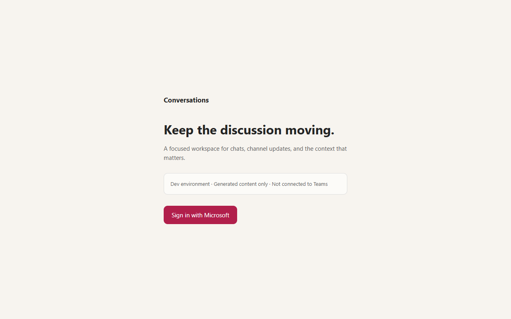
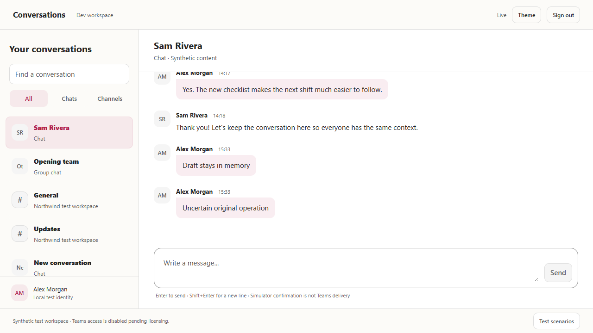

# Dev functional validation report

**Current outcome (2026-10-19): GraphPilot real-Teams basic validation is deployed in Sweden Central. Alex, Sam and Jordan each passed fresh password/TOTP, dedicated chat/channel reads, chat send, channel post and thread reply with actual Graph creation IDs and matching author/content read-back. Optional passkey registration was deferred only through Entra's offered Not now control with explicit user approval; MFA/security policies were unchanged. See [current basic-mode evidence](graph-pilot.md).**

The remaining report preserves the earlier simulator rollout and local-validation history; its old image/revision and pending-journey entries are not the current GraphPilot status. The current API revision is `teamsrefdev-unc3jasrpkgbo-api--0000004`; no additional Azure resource or size was provisioned. Temporary setup application/service-principal counts were both verified zero after resource creation.

## New chat source integration (2026-10-19)

The executable frontend now adopts `prototypes\05-new-chat.html` with an explicit backend-capability boundary. It searches authorized, loaded chat titles, opens the existing chat/composer without a business POST, preserves independent in-page drafts, supports paged discovery, and distinguishes loading, empty, no-match and unavailable states. It does not invent profile/email information or create new chats. GraphPilot offers its dedicated approved chat without implying a one-to-one recipient.

| Local check | Result | Boundary |
| --- | --- | --- |
| React component regressions | **13 passed** | Includes catalog continuation/recovery, draft reuse, authorization expiry, honest capability labels and the retained 30-second pilot poll |
| Browser journeys in installed Edge | **19 passed** | Actual local simulator read/send/post/reply, uncertainty across chat switching without duplicate POSTs, rejected/offline sends, authorized history, offboarding, search recovery, and mocked GraphPilot metadata |
| Responsive/keyboard/theme checks | **Passed** | 1280px, 390px and 320px in light/dark; focus entry/return, Escape, Shift+Enter, IME non-submission, reduced motion, no horizontal overflow, zero business browser storage and no page-script errors |
| Sampled rendered text contrast | **At least 4.5:1** | Actual computed colors in the discovery heading, copy, input, result identities/actions and notes in both themes; not a full accessibility certification |
| Frontend production build/type-check | **Passed** | Vite build plus strict TypeScript; authentication-runner type-check also passed |
| Backend contracts | **92 passed** | Debug xUnit suite; no backend/API contract changes in the UI integration |
| Authentication-runner unit checks | **12 passed** | Controlled local checks only; no credentials loaded or live authentication performed |
| Mechanical UI detector | **No deterministic findings** | Human visual comparison also performed against the served local reference |

The live-validation helper now scopes conversation selection to navigation so the new search results cannot create ambiguous locators. This source UI is **not deployed** by this work. No real Graph write, cloud/identity mutation, consent, tenant setting, production-gate activation, commit or push was performed. Local simulator and mocked metadata checks do not replace the separate real-Teams evidence above.

## Earlier deployment history

**Application:** https://teamsrefdev-unc3jasrpkgbo-web-htdnfyf3dbbjbca2.b02.azurefd.net

**2026-10-19 identity update:** Fresh unattended password/TOTP sign-ins are verified for Alex, Sam and Jordan with Chromium and expected Entra-backed `/api/session` responses. The source fixture dataset is now `split-view-v2` with these three personas; Jordan also covers the group-chat history cutoff. The deployment evidence below describes the earlier `split-view-v1` rollout and is not proof that the three-user image/data migration has been deployed. Final local credentials use `TEST_ALEX_*`, `TEST_SAM_*` and `TEST_JORDAN_*`; no credential values or session material belong in this report.

| Context | Value |
| --- | --- |
| Validation date | Local application: 2026-10-15; deployment retries and region wiring: 2026-10-16 |
| Source | Local implementation checks based on `fa09e7f`; deployment retry working tree based on `bb55dee`. This deployment work made no commits or pushes. |
| Environment | Windows, .NET SDK 10.0.402, Node 22.14.0, npm 10.9.2, installed Edge |
| Dataset | Source: `split-view-v2`, six conversations, three synthetic personas. Earlier hosted rollout: `split-view-v1`. |
| Azure target | Subscription `67bfd3c6-6d7e-4a79-9a85-19f4a6928d7c`; resource group `rg-teams-reference-dev-swc`; region `swedencentral` |
| API image | `acrteamsrefdevunc3jasrpkgbo.azurecr.io/teams-reference@sha256:15c16ae26cc95df0cd21790bc2d6a05d31f086299e9d51b2e4fb8d04e370d37c` (ACR `dt3`) |
| Worker/seed image | Existing `dt2` image `sha256:119dcb11117bd12d0daf9c9c70435186ac423958f67ae7a4cdda2d0f13657905`; unaffected by the API-only callback fix |
| Deployment result | Baseline `teams-reference-release`: `Succeeded`; API-only callback correction rolled out to healthy active revision `teamsrefdev-unc3jasrpkgbo-api--0000003` |
| Authentication exercised | Local cookie/CSRF journeys; deployed canonical Entra redirect and actual first-login attempt reaching mandatory security enrollment. No completed deployed user session is claimed. |
| Persistence exercised | Real Azure Cosmos seeding/verification and Redis readiness through private endpoints; no claim that all hosted send transactions or failure cases have passed |

## Checks executed

| Check | Result | Evidence / boundary |
| --- | --- | --- |
| Backend/domain/API/Graph-transport contracts | **37 passed** | Includes a real middleware/MSAL code-redemption regression with a controlled identity transport, six invalid-origin cases, and previous HTTP/CSRF/CSP/send coverage |
| Canonical callback regression | **Passed** | Under internal HTTP/origin-host forwarding, both authorization and the captured token POST use the same configured public HTTPS `/auth/callback`; PKCE remains present |
| React component tests | **4 passed** | Unknown-send safety, simulator labels, and server-controlled local-login visibility |
| Local browser scenarios | **8 passed** | Running local Web App in Edge; not a hosted authenticated journey result |
| Deployed public smoke | **Passed** | Compiled UI/asset load, fixture and Redis readiness, anonymous API 401, disabled local sign-in, correct Entra tenant/client/callback redirect |
| Deployed browser rendering | **Passed** | Actual Sweden site, desktop light and mobile dark, no overflow, local-login option hidden, zero CSP violations |
| Origin and TLS boundary | **Passed** | Direct public Container Apps origin returns 403; HTTP public origin redirects to HTTPS with 307 |
| Hosted authenticated journeys | **Pending fresh sign-in after callback fix** | Consent is verified. The user's subsequent callback failed with `AADSTS500112`; the canonical URI fix is deployed and regression-tested, but a completed new user session/business journey remains unverified. |
| TypeScript and production frontend build | **Passed** | Vite build and strict type checking |
| Locked .NET restore and Release publish | **Passed** | Published frontend `wwwroot` assets verified present |
| Bicep / ARM | **Compiled and deployed** | Sweden platform and corrected workload rollout succeeded. This is not production capacity or SLO certification. |
| GitHub Actions | **Lint passed** | actionlint 1.7.7; remote workflow not executed |
| PowerShell management scripts | **Parse and 6 isolated checks passed** | Explicit subscription, checkpointing, Sweden region, required network feature, strict workload identities and early tenant mismatch denial |
| Sign-in consent helper | **5 isolated checks; user-approved grants verified** | Exactly four user-specific sign-in grants, no tenant-wide grant, and assignment restriction remains enabled. This is not a completed browser authorization test. |
| UI mechanical detector | **No deterministic findings** | Not an accessibility certification or performance result |
| Azure ARM preflight | **Passed in Sweden** | Redis B0 and Cosmos allocated successfully; earlier German capacity denials remain historical |
| OCI container build | **Succeeded** | Sweden ACR `dt1`, UI/CSP correction `dt2`, and canonical callback correction `dt3`. The latest fix was scoped to the API. |
| Real-time configuration | **Configured** | Protected managed-identity PubSub connect handler and API admission flag enabled; user connection/render journeys remain unverified until sign-in completes |
| Load testing / regional recovery | **Excluded by request** | No tooling, execution, capacity result, or load report |

Backend evidence covers command replay/payload conflicts, concurrent duplicate submission while the budget is occupied, conditional expiry of an undispatched claim, unknown receipt resolution, ownership checks, history/parent visibility, revocation/offboarding, equal-timestamp pagination, coverage gaps, tombstones/out-of-order changes, fixture reset epochs, serialized projection bounds, and live HTTP send outcome classification without POST retries.

The simulator restart test creates a new simulator instance against the same store. It does not claim that the local memory store survives a server-process restart or that Cosmos/broker crash recovery has been demonstrated.

Final browser validation exposed shared-actor rate-budget coupling between cases. The harness now waits for actual send responses, distinguishes confirmed content from optimistic rendering, and respects the unchanged 1.25-second sender budget between cases. The final complete eight-case run passed with no retries or limiter relaxation.

## Local browser journeys

1. Browse and page conversations, preserve an in-memory draft across navigation, send once, and sign out.
2. Navigate channel threads, send a reply, receive a queued external update, and render hostile markup as text rather than HTML.
3. Lose send confirmation, block automatic resend, check the original operation, and show exactly one created message.
4. Sign in as the restricted persona and deny both discovery and direct access to another conversation.
5. Offboard an already signed-in persona, deny its existing session, close its local real-time connection, and clear its open view.
6. Reject a send without creating a message; disable sending offline while retaining only the open-page draft; restore sending availability online.
7. Apply external edits/deletions through the inbox/worker/hint/refetch path.
8. Exercise desktop/mobile Split View navigation, themes and wrapping, and verify zero localStorage/sessionStorage entries for the test application.

The suite starts/stops its own localhost host. No long-lived dev server was intentionally left running. Local SSE exercises application hint/refetch logic, not Azure Web PubSub's protocol, identity, network rules, admission, or connection capacity.

## Hosted deployment evidence

The dedicated resource group contains the API and worker Container Apps, seed job, Cosmos DB, Managed Redis B0, Service Bus Premium, Web PubSub, Key Vault, ACR, telemetry, VNet and private data endpoints. Front Door Premium/WAF are global resources with a Sweden private-origin connection. Runtime remains `Simulator`; no Teams messages or existing business content are accessed.

The initial compute environment failed before infrastructure initialization because the subscription lacked `Microsoft.Network/AllowBringYourOwnPublicIpAddress`. Registering the feature did not fully repair that already-created empty environment: apps had no revisions and the seed pod could not start. Only those newly created empty compute resources were recreated; the data services and identities were preserved. The working environment is `teamsrefdev-unc3jasrpkgbo-env-ready` on the dedicated `container-apps-ready` subnet. The original subnet is retained while Azure completes old-environment cleanup.

An actual browser then caught a CSP hash mismatch caused by CRLF versus HTML parser newline normalization. The hash calculation was corrected without adding `unsafe-inline`; regression coverage and a new image were deployed. Azure sign-in now hides the unavailable local-login option based on a credential-free server capability response.

The final seed execution `teamsrefdev-unc3jasrpkgbo-seed-wmlmjnr` succeeded after seeding/verifying the allowlisted dataset. Repeated seeding did not reset it. Public `/health/ready` returned exactly `status=ready`, `mode=simulator`, and `fixtureVersion=split-view-v1`.

The first Entra login attempt used the dedicated Alex account without logging its password or exporting browser tokens. It stopped at mandatory security setup. Complete that interaction manually, then execute the authenticated scenarios against the public app; current public smoke results are not a substitute.

The later user screenshot showed an additional **"Need admin approval"** gate for `teams-reference-dev-web`. The live authorization redirect requests exactly `openid profile offline_access`, with an empty static `requiredResourceAccess` list. Initially, no grant existed. The user then explicitly approved and executed the user-specific helper. A subsequent read verified four `Principal` grants with exactly those scopes, zero tenant-wide grants, and `appRoleAssignmentRequired=true`. No Teams, chat, mail or file permissions, MFA changes, or app redeployment were needed. Fresh sign-in must still verify Entra acceptance and the resulting BFF session.

### Callback URI correction

The user's next sign-in reached `/auth/callback` but returned `dependency_unavailable`, trace `0HNPBCP2ANTDE:00000015`. Azure logs for that exact trace identified `AADSTS500112` / `invalid_client`: authorization used the public HTTPS Front Door callback, while MSAL code redemption reconstructed an internal HTTP Container Apps callback. The dependencies themselves remained ready.

`PublicAuthenticationOrigin.AddCanonicalOidcCallback` now configures both the OIDC authorization redirect and the named MSAL confidential-client redirect from the same validated `App:PublicOrigin`. It does not register an internal HTTP reply URL, trust arbitrary forwarded hosts, weaken TLS/token validation, or change consent/MFA. Existing redirect event handlers are awaited and preserved.

`OidcCallbackTests` uses the actual OIDC middleware and MSAL redemption path with proxy-like internal HTTP/host values, real protected state/correlation cookies, and a controlled identity HTTP transport. It asserts the actual token POST's `redirect_uri` matches the public authorization callback and retains a PKCE verifier. The transport intentionally rejects the synthetic code after capture; this is not a real Entra session test.

ACR `dt3` was built and rolled out only to the API. Its active revision `--0000003` is Healthy/Running, and deployed public smoke checks pass. A new Alex sign-in is still needed; an already-used authorization response or direct refresh of `/auth/callback` cannot validate the fix.

## Visual evidence

These screenshots contain generated test content only.



[Deployed Sweden sign-in, mobile dark](validation/sweden-signin-dark.png)

The following earlier screenshots show the local authenticated Split View, not an authenticated Azure session:



[Mobile dark-theme Split View](validation/split-view-mobile.png)

Local detailed outputs are generated under `tests\Teams.Tests\TestResults`, `src\Web\playwright-report`, and `src\Web\test-results` and are ignored by Git. CI publishes only backend results and screenshots; traces are off by default and HTML credential-entry reports are not uploaded.

## Blocking prerequisites and remaining scope

### Deployment retries

The user re-enabled the initial subscription on 2026-10-15. After propagation, actual-identity ARM validation/what-if succeeded, tagged Entra identities and partial Azure infrastructure were created, and ACR build `cb1` successfully built a Linux container. Full platform deployment did not succeed: West Europe Cosmos access and Redis B0/B1 allocation were denied. A North Europe Cosmos fallback was created; no functioning public application was established. The original resources were left untouched when the target changed.

On 2026-10-16, the user selected subscription `67bfd3c6-6d7e-4a79-9a85-19f4a6928d7c`, in tenant `f1640304-f816-412c-9e6f-4b6b818cf492`. Initial bootstrap stopped at user creation with `Authorization_RequestDenied` under Global Reader. The later session included Global Administrator and completed all four dedicated users, assignments, and managed-identity/callback bindings. No old-tenant IDs or fabricated fixture users were substituted.

The bootstrap scripts accept explicit subscription selection without changing the CLI default, reject mismatched tenant inventories before external calls, and preserve partial progress as `bootstrapComplete=false`.

The user next selected Germany West Central, where Redis B0/B3/B5 preflights failed. The subsequent explicit Sweden Central selection succeeded. Current Bicep defaults, parameter templates, platform metadata, private-origin placement and GitHub Actions inputs use `swedencentral`, targeting `rg-teams-reference-dev-swc`.

Cosmos access is allowed in Germany West Central. Actual Germany subscription what-if attempts with Managed Redis Balanced B0, B3 and B5 each failed with `BadRequest`/`InvalidTemplateDeployment`, reporting insufficient capacity for this subscription in that region. No complete Germany apply was attempted after those failures. The reports are not successful capacity or deployed-app validation.

Platform provisioning is independent of test-user creation, but application/seed deployment now requires three distinct approved fixture actor IDs, enforced by the release script, nested workload template and host startup. Isolated PowerShell checks cover this separation and the network prerequisite. No authentication bypass was introduced.

| Gate | Current state |
| --- | --- |
| Enabled Azure target | Current subscription is Enabled; Sweden resources are deployed in their dedicated group. |
| Directory bootstrap | Four tagged apps/principals; the active test users are Alex, Sam and Jordan. Web assignments, redirect URI, managed-identity trust and callback role are configured. |
| Sign-in consent | `openid profile offline_access` is approved for the three active assigned users; fresh password/TOTP sessions are verified. No Teams message permissions are implied. |
| Teams licensing | Alex, Sam and Jordan have user-approved E5 (no Teams) and Teams Enterprise licences with Netherlands usage locations. Real Teams readiness still needs separate approval and evidence. |
| Cloud deployment | Sweden rollout succeeded, real private-store seeding and public/browser smoke passed. Authenticated message/send/reconnect/revocation journeys await fresh sign-in and any remaining Entra first-use setup. Earlier-subscription resources remain separate and may still charge. |
| Git publication and remote CI/CD | No branch changes, commits, pushes, or remote workflow execution. Environment protection/OIDC/RBAC setup remains a bootstrap action. |
| Live Teams implementation/readiness | Runtime intentionally rejects live mode. Resource onboarding, current Graph entitlement/policy authority, rich callback/subscription/repair wiring and real-tenant validation remain unfinished. The isolated delegated-send transport is not a complete Teams integration. |

This evidence does **not** pass production gates G0-G7, demonstrate a 200,000-user envelope, prove a real Graph send/freshness SLO, certify DLP/history/offboarding equivalence, or authorize processing existing business data. The approved synthetic dev scope and remaining work are recorded in [ADR 0008](adr/0008-simulator-first-single-region-development.md).

## Reproduction

Use [test guidance](testing.md), [dev setup/deployment](dev-guide.md), and the versioned fixture manifest. For a fresh local environment:

```powershell
.\scripts\Validate.ps1 -Browser
```

For deployed public checks, run `scripts\Test-DeployedApp.ps1` with the actual origin, tenant and web client ID from the private inventory. Approve the narrowly scoped sign-in consent and finish any required security setup before the authenticated scenario pass. Do not replace missing evidence with simulator success or open private endpoints to make a check pass.
