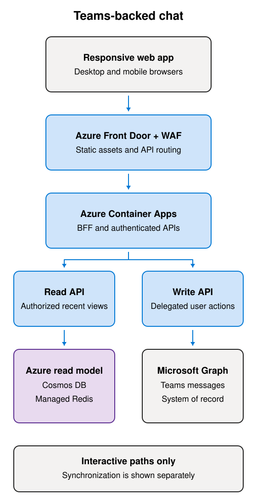
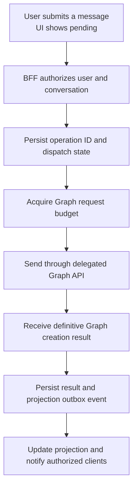
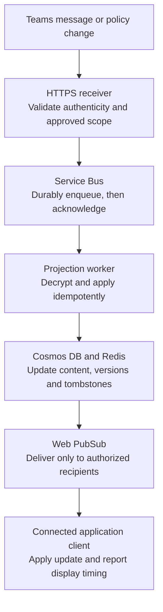

# Technical design: Teams-backed chat reference implementation

Companion: [Detailed architecture](detailed-architecture.md) covers Azure/Entra components, software/data contracts, runtime sequences, and implementation-level recovery and operations.

| Field | Value |
| --- | --- |
| Document status | Draft reference implementation guide |
| Architecture decision status | ADRs 0001-0006 accepted for reference design; privacy-boundary ADR 0007 proposed; deployment acceptance remains conditional |
| Version | 0.1 |
| Public documentation reviewed | 2026-10-15 |
| Implementation status | Simulator-first dev slice added; see [dev guide](dev-guide.md) and [validation evidence](dev-validation.md). No production capacity or real Graph result is asserted. |
| Intended audience | Application engineers, architects, platform engineers, security reviewers, and performance engineers |

## Contents

- [1. Purpose and scope](#1-purpose-and-scope)
- [2. Requirements](#2-requirements)
- [3. Workload and capacity model](#3-workload-and-capacity-model)
- [4. SLIs and proposed SLOs](#4-slis-and-proposed-slos)
- [5. Microsoft Graph constraints and bottlenecks](#5-microsoft-graph-constraints-and-bottlenecks)
- [6. Azure architecture](#6-azure-architecture)
- [7. Interaction and synchronization design](#7-interaction-and-synchronization-design)
- [8. Identity, authorization, and data protection](#8-identity-authorization-and-data-protection)
- [9. Resilience and regional recovery](#9-resilience-and-regional-recovery)
- [10. Observability and operational governance](#10-observability-and-operational-governance)
- [11. Load testing and acceptance](#11-load-testing-and-acceptance)
- [12. Implementation stages](#12-implementation-stages)
- [13. Risks and deployment decisions](#13-risks-and-deployment-decisions)
- [14. Architecture decision records](#14-architecture-decision-records)
- [15. References](#15-references)

## 1. Purpose and scope

Define a cloud-native, responsive web application that lets authenticated users read and send Microsoft Teams chat and channel messages through Microsoft Graph.

The design follows Microsoft's embedding reference: retrieve messages once where practical, cache a bounded working set, subscribe to changes, and deliver updates to clients through a server component [R1]. It applies Graph guidance on least privilege, paging, throttling, response handling, and data retention [R2].

**Core design:** Teams remains the system of record. Azure maintains a bounded, authorized recent-message projection so that normal reads do not wait for Graph. User-authored writes require Graph confirmation and remain constrained by Teams.

The projection is a performance-oriented proposal, not permission to retain personal data. [ADR 0007](adr/0007-message-content-processing-and-storage-boundary.md) makes selection and approval of the processing/storage boundary an explicit prerequisite. If policy does not permit the proposed content copy, the relevant architecture and performance assumptions must change.

The workload assumptions in this guide are synthetic. They are not operational measurements from a deployment. No existing implementation, comparable-scale production result, or guaranteed Graph capacity is asserted.

The executable dev delivery is scoped separately by [ADR 0008](adr/0008-simulator-first-single-region-development.md). It does not implement regional recovery or load testing, and its bounded data model is not evidence for this document's production envelope. The statement above concerns production/reference-scale implementation evidence, not the existence of the dev code.

### In scope

- Responsive desktop and mobile-browser chat/channel views.
- Recent messages, replies, edits, deletions, and relevant policy changes.
- User-authored message sending through documented delegated APIs.
- Event-driven projection maintenance and authorized real-time delivery.
- Bounded bootstrap, reconciliation, retention, and history retrieval.
- Identity lifecycle enforcement, observability, recovery, and load testing.

### Out of scope for the initial reference

- A complete reproduction or iframe embedding of the Teams client.
- Calling, meetings, presence, typing indicators, and full Teams feature parity.
- Persistent offline storage of business content on user devices.
- Unbounded archive replication or a replacement compliance archive.
- Background impersonation of users or migration APIs used for normal sends.
- A durable offline-send queue. Its authorization and delivery semantics need a separate decision.

Attachment metadata and authorization must be supported where selected. Attachment transfer sizes, SharePoint/OneDrive limits, download policy, and bandwidth require a separate workload model; they are not included in the text-message capacity figures.

## 2. Requirements

| ID | Requirement | Design implication |
| --- | --- | --- |
| FR-01 | Display authorized recent chat and channel content | Query the Azure projection, including history-visibility restrictions |
| FR-02 | Send messages as the signed-in user | Use delegated Graph authorization and explicit delivery state |
| FR-03 | Reflect changes made through other Teams clients | Ingest rich change notifications and reconcile gaps |
| FR-04 | Process relevant system events without cluttering the feed | Maintain separate displayable-content and control-state handling |
| FR-05 | Support mobile browsers and reconnection | Small payloads, stable cursors, virtualized views, and projection-based catch-up |
| NFR-01 | Accommodate 200,000 connected users | Separate connections, active interactions, Graph calls, and fan-out |
| NFR-02 | Provide predictable recent-read latency | Avoid synchronous Graph hydration in the normal read path |
| NFR-03 | Preserve delivery correctness | Never equate application acceptance with Teams confirmation |
| NFR-04 | Enforce access and offboarding across reads and pushes | Authorization must apply to copied data and active connections |
| NFR-05 | Retain only an approved working set | Define expiry, deletion, queue, log, and backup policies |
| NFR-06 | Recover from zone and regional failures | Replicate required state and provision full failover capacity |
| NFR-07 | Make dependency behavior supportable | Trace individual Graph attempts, retries, paging, and complete user operations |
| NFR-08 | Demonstrate the actual acceptance envelope | Test capacity, real Graph behavior, security correctness, and browser experience separately |
| NFR-09 | Approve the personal-data processing and storage boundary | Select an explicit privacy profile before enabling its real-data path; assess all copied, encrypted, derived, and operational records |

Unauthorized disclosure is not an acceptable error-budget outcome. Availability or latency targets do not relax access-control requirements.

### 2.1 Privacy and data-handling prerequisites

Privacy is an architecture input, not a database setting or a substitute for performance evidence. The design must distinguish a restriction on durable copies from restrictions on RAM caches, backend plaintext processing, particular products/locations, or all personal data outside Microsoft 365.

| Required decision | Approval scope |
| --- | --- |
| Purpose and content boundary | Permitted use, message-body processing, memory caching, durable storage, approved fields/previews and resources |
| Identity and metadata | Users, membership, resource identifiers, timestamps, operation evidence and derived/linkable values |
| Hosting and access | Approved regions/infrastructure, tenant separation, runtime/operator access, history and policy enforcement |
| Lifecycle and copies | Retention/expiry, deletion, legal/policy requirements, queues/DLQs, outboxes, backups, diagnostics, exports and client storage |
| Architecture and evidence | Selected option, changed data/authentication flows, Graph budget, SLO populations and recovery objectives |

Keep the full [P01-P13 trade-off comparison](detailed-architecture.md#56-privacy-and-storage-options) in the detailed architecture as the canonical table. P07, the bounded full Cosmos DB projection with Redis, remains the reference candidate subject to approval. Alternatives include no-copy, metadata-only, ephemeral, minimized, encrypted, hybrid, and different experience/platform patterns; they are not implemented runtime fallbacks.

Encryption and pseudonymization do not automatically make data anonymous. An approved memory cache still handles personal data, and encrypted rich notifications can still create a durable content copy. Graph admin consent and licensing do not approve these additional purposes.

Use [ADR 0007](adr/0007-message-content-processing-and-storage-boundary.md) to record the proposed boundary and eventual approved selection. No permitted profile is inferred from its **Proposed** status. Gate G0 applies before enabling the selected real-data processing/storage path; experiments using approved synthetic/test data can proceed without implying approval for production content.

Projection-specific design implications and recent-read targets in this TDD are conditional on the profile. No-copy and hybrid variants require revised dependency demand, measurement populations, and acceptance evidence; a faster target cannot justify an unapproved data copy.

## 3. Workload and capacity model

### 3.1 Definitions

| Dimension | Definition |
| --- | --- |
| Connected user | A signed-in user with one or more active application connections |
| Active reader | A connected user performing read interactions during the measurement interval |
| Active sender | A connected user submitting messages during the interval |
| Application RPS | Requests to the application API, not static assets or WebSocket deliveries |
| Graph RPS | Individual Graph operations, including subrequests, pages, and retries |
| Ingestion rate | Subscribed message/control changes, including activity originating outside this application |
| Delivery rate | Individual recipient deliveries after fan-out |

Use measured action frequencies rather than translating registered users, daily users, or weekly users directly into RPS.

```text
Read RPS = connected users * active-reader fraction * reads per reader per second
Send RPS = connected users * active-sender fraction * sends per sender per second
Graph demand = hydration + reconciliation + writes + control operations + retries
Recipient deliveries per second = updates per second * connected recipients per update
```

### 3.2 Synthetic planning scenarios

| Assumption | Baseline | Busy period |
| --- | ---: | ---: |
| Connected users | 200,000 | 200,000 |
| Active readers | 10%: 20,000 | 25%: 50,000 |
| Read frequency per active reader | One per 10 seconds | One per 5 seconds |
| Application read RPS | 2,000 | 10,000 |
| Active senders | 0.5%: 1,000 | 1%: 2,000 |
| Send frequency per active sender | One per 120 seconds | One per 60 seconds |
| Message-send demand | 8.33 RPS | 33.33 RPS |
| Other application API traffic allowance | 400 RPS | 2,000 RPS |
| Total application API demand | 2,408.33 RPS | 12,033.33 RPS |

Read frequency describes interactions with application-owned views. It is not a recommendation to poll Graph.

The send mix is intentionally unspecified. If all busy-period sends target chats in one tenant/application, the 33.33-RPS demand exceeds the documented 20-RPS ceiling. Spreading sends across chats does not remove the tenant/application ceiling. Channel sends have a different aggregate ceiling but still have conversation and user limits.

### 3.3 Engineering envelope

| Dimension | Initial reference target |
| --- | --- |
| Application API | 15,000 sustained RPS at the defined request mix |
| Short-burst stress | 30,000 RPS for up to five minutes, initially using a Graph simulator |
| Expected connections | 240,000, assuming 1.2 connections per connected user |
| Provisioned connection capacity | At least 300,000, subject to fan-out, bandwidth, and supported unit counts |
| Regional recovery | The surviving region can carry the full production envelope |
| Graph traffic | Independently budgeted by operation, app/tenant, conversation, and user |

This is an acceptance envelope, not a SKU-based proof that capacity is available.

### 3.4 Additional sizing inputs

- Include external Teams activity, edits, deletions, and control events in ingestion sizing.
- Measure recipient fan-out. A single update to 200,000 connected recipients produces 200,000 deliveries.
- Measure response size. At 10,000 reads/s, 20-KB responses represent approximately 200 MB/s before compression.
- Model reconnect traffic. Spreading 200,000 negotiations over 60 seconds still produces approximately 3,333 negotiations/s, before additional bootstrap requests.
- Model retained messages, average payload size, indexes, operation records, tombstones, backups, and queue retention.
- Avoid copying message bodies into a separate durable document for every recipient.
- Include hot-conversation cache bandwidth and Cosmos partition limits; aggregate database capacity does not eliminate a hot partition.
- Treat authentication/token acquisition and attachment transfer as separate capacity dimensions.

## 4. SLIs and proposed SLOs

### 4.1 Measurement policy

Use a rolling 30-day window for availability and operation-success SLOs. Collect latency distributions in shorter operational windows and over the same evaluation period.

Segment by operation, chat/channel, recent/older history, warm/cold state, region, network/device class, and workload scenario. Cache misses for normal recent content remain in the recent-read population.

An eligible operation is a valid request for a supported action by an authorized user. Expected validation/access denials are tracked separately. Valid requests rejected by capacity controls, dependency throttling, timeouts, or uncertain outcomes count as failures; do not exclude them to improve the result.

Measure business operations once while also recording every Graph attempt. Start latency measurement before retries and waiting. Timeouts and failures remain in the operation population, not only in successful-response percentiles.

A usable initial recent-message page contains the first 20 authorized, displayable messages in the requested working range when that many exist, or all available messages when fewer exist. A projection coverage gap is not a valid empty conversation. Reply expansion and older-history loading must not block this initial page.

### 4.2 Targets

| SLI | Proposed SLO | Measurement boundary |
| --- | --- | --- |
| Recent-read availability | 99.95% of eligible requests return authorized, usable content within 5 seconds | Application ingress through response, including normal recent-view cache misses and Azure dependencies |
| Recent-view latency | p95 <=1 second; p99 <=2.5 seconds | User interaction through usable content rendered; already authenticated, representative mobile network |
| Message-send success | 99.9% of eligible sends confirmed by Graph within 30 seconds | User submission through known Graph confirmation; dependency-gated |
| Message-send latency | p95 <=3 seconds; p99 <=10 seconds | Complete send operation, including budget waits and retries; dependency-gated |
| Webhook durable acknowledgment | p99 <=1 second; 99.9% within 3 seconds | Notification received through validation, durable enqueue, and response |
| Notification processing/display | p99 <=5 seconds | Notification receipt through projection update and reachable connected-client display |
| External Teams change freshness | Candidate p95 <=15 seconds; p99 <=65 seconds | Service creation/update timestamp through application display; dependency-gated |
| Offboarding enforcement | p99 <=60 seconds after receipt of an authoritative offboarding event | Application denial of subsequent operations and closure of affected connections |
| Regional recovery | Candidate RTO <=15 minutes; read-model RPO <=5 minutes | Recovery of the required application/read-model envelope, not Microsoft 365 recovery |

All values are preliminary acceptance targets. They are not existing results, contractual commitments, or Microsoft service guarantees.

Microsoft documents expected `chatMessage` notification delivery as less than 10 seconds on average and one minute maximum [R9]. This is not a percentile SLA. The proposed external-change freshness target includes additional application processing time and must be validated.

### 4.3 Success is not just a fast HTTP response

- A skeleton, empty placeholder, `202`, or local pending message is not usable content or a confirmed send.
- A read that quickly returns stale data may pass availability while failing freshness. Dashboards must show both; the business journey is not healthy merely because the cache returned `200`.
- Determine freshness from change/coverage evidence, not only the age of the last message. An inactive conversation with old messages is not necessarily stale.
- A Web PubSub publish acknowledgment is not proof that a client displayed the update. Instrument client receipt/rendering or controlled end-to-end probes.
- A user message is labeled sent only after known Graph creation. Optimistic pending display can have a separate UX target but cannot satisfy send success.
- Offboarding timing starts at receipt of the authoritative event. Measure the upstream identity-lifecycle delay separately; do not imply immediate revocation from a delayed notification source.
- Older history, first-time hydration, attachments, and interactive sign-in require separately measured targets before production acceptance.

The request-based recent-read error budget is 0.05% of eligible requests. It is not automatically equivalent to a downtime allowance. Alert on short- and long-window budget burn.

## 5. Microsoft Graph constraints and bottlenecks

### 5.1 Documented limit snapshot

The following snapshot comes from public Microsoft documentation reviewed on 2026-10-15 [R3]. Recheck it during implementation and before each capacity review.

| Operation | Per app across tenants | Per app per tenant | Conversation/user limit |
| --- | ---: | ---: | --- |
| List chat messages | 200 RPS | 20 RPS | 1 RPS per chat |
| List channel messages | 200 RPS | 20 RPS | 1 RPS per channel |
| Send chat message | 200 RPS | 20 RPS | 1 RPS per chat and per user |
| Send channel message or reply | 500 RPS | 50 RPS | 1 RPS per channel and per user |
| List chats | 200 RPS | 20 RPS | 1 RPS per user |
| Get chat metadata | 2,000 RPS | 200 RPS | 1 RPS per chat; 5 RPS per user |
| List chat hosted content | 500 RPS | 50 RPS | 1 RPS per chat |

Multiple dimensions apply simultaneously. Microsoft documents short burst windows and a longer-window sustained limit of approximately 83% of the listed rate. Published ceilings are neither recommended operating rates nor guaranteed throughput.

The global Graph limit of 130,000 requests per 10 seconds per app across tenants does not override lower Teams limits. Confirm endpoint bucket sharing and resource-specific behavior with Microsoft; do not assume every table row grants an independent, additive budget.

### 5.2 Write throughput and hot conversations

The baseline 8.33 sends/s may fit an appropriate confirmed budget. The all-chat busy scenario of 33.33 sends/s does not fit the published 20-RPS tenant/application ceiling.

Queueing can absorb a bounded burst but cannot increase sustainable Graph throughput. If arrival rate exceeds dispatch capacity, backlog and delivery latency grow. A hot conversation can reach its 1-RPS ceiling even when the tenant/application has spare capacity.

A workload requiring higher sustained writes is a go/no-go question. Do not split registrations to evade throttling. Additional app identities must have legitimate permission boundaries, not serve as an assumed capacity multiplier.

### 5.3 Cache misses and read amplification

For illustration only, allocate 12 Graph message-list RPS to cache-miss hydration and assume three pages per miss:

| Application read rate | Maximum independent hydrations/s | Required hit rate |
| --- | ---: | ---: |
| 2,000 RPS | 4 | At least 99.8% |
| 10,000 RPS | 4 | At least 99.96% |

This optimistic example assigns the entire illustrative budget to misses. Real reconciliation and other work reduce the available allowance.

Use notifications with resource data, pre-hydration, shared conversation views, and single-flight request coalescing. More readers of the same conversation should not produce more independent Graph reads.

On cache failure, use bounded projection reads, not unconditional Graph fallback. Missing projection data has an explicit loading/unavailable state and a budgeted hydration job; it is not a success-shaped empty result.

### 5.4 Pagination, filtering, and system events

Chat and channel message lists allow a maximum `$top` of 50 [R5, R6]. Channel replies have their own paging and expansion behavior. Ten dependent pages at 500 ms each already require approximately five seconds before other processing.

Follow complete `@odata.nextLink` values as opaque URLs. Do not reconstruct tokens, invent future page URLs, or assume batching can execute unknown subsequent links.

The list endpoints do not support arbitrary `$select` or a filter excluding system messages. Use only documented query options for the exact endpoint/version. Channel ordering reflects the modified reply chain; it is not equivalent to a simple chronological message stream.

Build displayable-content indexes in Azure. Preserve and process control events, membership/history effects, policy updates, and unknown enum handling separately.

### 5.5 Notifications and subscription quotas

The documented organization-wide limit is 10,000 active Teams subscriptions, shared across applications and Teams resource types [R7]. A subscription per browser or per 200,000 users is not viable.

Prefer the narrowest suitable aggregate scope. An installed-to-chats stream requires a Teams app installed in the intended chats; it is not automatically scoped by the web application's Entra registration. Approved tenant streams are an alternative where narrower scopes cannot meet the use case.

Broad subscription scope requires explicit privacy and permission approval. Filter out-of-scope resources before durable storage where possible, and do not treat broad read permission as end-user authorization.

Rich notifications contain encrypted resource data and can avoid an additional GET per event [R8, R10]. Certificate rotation, authenticity checks, subscription renewal, and reconciliation are mandatory.

Use the current resource/payload-specific expiry requirements and the accepted expiry returned by Graph. A Teams subscription requested for more than one hour requires `lifecycleNotificationUrl` [R8, R9]. Do not assume all resources support delta or `missed` lifecycle notifications [R11].

### 5.6 Batching, retries, and latency

JSON batches support up to 20 subrequests [R12]. Reads and writes can be batched where supported, but:

- Each subrequest still consumes applicable capacity and can fail independently.
- Outer HTTP `200` does not imply successful operations.
- A batch uses a single authorization context; do not combine different users' delegated writes.
- SDK retry behavior for ordinary calls is not equivalent to handling throttled subrequests.
- Batch only suitable independent operations; it does not remove cursor dependencies or write ceilings.

Honor `Retry-After`, limit concurrency, and coordinate SDK and application retry policies [R4]. Backoff and paging can magnify a modest per-call latency into a long user operation. A slow operation alone is not evidence of throttling; collect statuses and attempt timings.

## 6. Azure architecture

### 6.1 Readable vertical overview



The overview intentionally excludes synchronization loops and cross-cutting services. It is an interactive-path view, not a complete network topology. Focused flows appear in [section 7](#7-interaction-and-synchronization-design). [Editable Excalidraw source](diagrams/architecture-overview.excalidraw).

### 6.2 Components

| Responsibility | Service | Reference design |
| --- | --- | --- |
| Public entry and static delivery | Azure Front Door Premium, WAF, static asset origin | Route to healthy origins; cache application shell/assets, not authenticated message responses |
| Authenticated application APIs | Azure Container Apps | BFF, read API, write API, and client connection negotiation |
| Durable recent-message projection | Azure Cosmos DB for NoSQL | Conversation-oriented data, membership/history metadata, operation state, outbox, and deletion tombstones |
| Hot views and coordination | Azure Managed Redis | Shared recent views, session/revocation state, single-flight coordination, and distributed request controls |
| Notification acceptance | Small Container Apps webhook service | Public HTTPS validation and durable acceptance; no Graph hydration during acknowledgment |
| Durable event buffering | Azure Service Bus Premium | Notification work, bounded retry, dead-letter handling, and repair workflows |
| Projection and reconciliation | Container Apps workers | Idempotent change handling, cache updates, catch-up, subscription management, and expiry |
| Client fan-out | Azure Web PubSub Premium_P2 | Authorized server-to-client groups, reliable reconnect, and managed connections |
| Identity and credentials | Microsoft Entra ID, MSAL, Key Vault, managed identities | Distinct interactive/background responsibilities and protected server-side credentials |
| Operations | Azure Monitor, Application Insights/OpenTelemetry, Log Analytics | SLOs, dependency attempts, service health, capacity, and support evidence |

Container Apps is the starting compute choice because managed client connections remove the need for 200,000 sockets on API replicas. Use dedicated workload profiles, supported zone redundancy, nonzero minimum replicas, and measured scale rules. Validate ingress, networking, CPU, replica, and environment quotas [R21].

API Management is optional when gateway governance requires it. It is not assumed to increase Graph capacity or replace application-specific authorization and rate controls.

### 6.3 Connection capacity and regional quotas

Public documentation lists 1,000 concurrent connections per Standard/Premium unit [R14]:

| Capacity dimension | Documented value / implication |
| --- | --- |
| Standard or Premium_P1 instance | Maximum 100 units, or 100,000 nominal concurrent connections |
| Premium_P2 instance | 100-1,000 units, up to 1,000,000 nominal concurrent connections |
| Reference 300,000-connection capacity | 300 units on connection count alone; validate supported provisioning and actual traffic |
| Default regional subscription unit quota | 150 total Web PubSub units |
| Required quota preparation | Request at least 300 units per deployment region, plus existing usage and any additional measured capacity |

Connection count alone does not establish message throughput. Benchmark fan-out, payload size, group distribution, server load, and bandwidth.

Premium supports zone redundancy in supported regions and geo-replication [R13]. Size each surviving replica for the full failure scenario. Reactive autoscale typically takes three to five minutes [R15]; pre-warm predictable peaks.

### 6.4 Deployment topology

Start with one active application region and a warm recovery region in approved locations. Use a single authoritative write region for application operation state unless a later ADR defines active-active conflict and delivery semantics.

Replicate the required Cosmos state and design notification-queue recovery explicitly. Do not mistake a metadata/alias disaster-recovery feature for message-data replication. Redis is rebuildable; its loss must not bypass authorization or rate limiting.

Use private connectivity for sensitive service dependencies and supported origins. Internet browsers still need an approved public client connection endpoint, and Graph webhooks require a reachable HTTPS endpoint. Public connectivity does not grant anonymous API or group-publish privileges.

Infrastructure as code must express regional availability, quotas, zone settings, health routing, minimum capacity, networking, and recovery configuration.

## 7. Interaction and synchronization design

### 7.1 Recent-read path

1. Authenticate the application session and check revocation/authorization state.
2. Enforce conversation access, visible history, content policy, and projection coverage.
3. Read the shared hot view from Redis; use bounded Cosmos queries on a miss.
4. Return a stable application cursor, authorized content, and coverage/freshness metadata.
5. Render usable content and measure end-to-end latency.

No routine Graph polling or synchronous multi-page scan occurs in this path. Pre-hydrate the working set before opening it to traffic. If the projection has a gap, schedule coalesced, budgeted repair and expose that state explicitly.

Use conversation-scoped documents and efficient membership/inbox indexes. Bound the first page and response size. Popular conversations need appropriate cache handling to avoid a hot Cosmos partition.

### 7.2 Confirmed-write path



This diagram shows the confirmed happy path. Non-success outcomes are explicit:

| State | Meaning and handling |
| --- | --- |
| Pending | Application has recorded the operation; Teams creation is not confirmed |
| Confirmed | Graph creation is known; retain the Graph message ID and report sent |
| Rejected | A definitive non-commit outcome is known; show the reason/retry guidance |
| Unknown | Timeout, disconnect, or recovery makes commitment uncertain; do not automatically resend |
| Projection pending | Graph creation is known but local synchronization is incomplete; preserve confirmation, expose synchronization status, and repair |

Require a per-user operation ID and payload fingerprint to coalesce repeated submissions and detect conflicting reuse. Colocate the operation result and outbox record where a Cosmos transactional batch can commit them together.

There is no distributed transaction with Graph. If Graph commits before a local failure, a missing local result is not proof that sending failed. Reconcile using available results/notifications; surface unresolved uncertainty rather than claiming exactly-once delivery.

The normal message APIs use delegated `ChatMessage.Send` or `ChannelMessage.Send` as appropriate [R16, R17]. `Teamwork.Migrate.All` is not a normal user-sending identity.

Budget waiting and retries must fit the end-to-end deadline. The baseline does not enqueue sends for indefinite background replay. If capacity cannot be acquired, return an explicit capacity outcome; eligible rejected sends remain in SLO accounting.

### 7.3 Notification synchronization path



Validate webhook challenges and notification authenticity according to the payload type, including `clientState`, validation tokens, encrypted content integrity, and certificate identity where required. Decryption keys stay in the protected backend.

Return `202` only after successful durable acceptance. If acceptance fails, return an explicit non-success response so Graph can retry [R18]. Do not hold acknowledgment open for database hydration or client fan-out.

Treat delivery as potentially duplicated and out of order. Use stable message/resource identities, version-aware updates, and tombstones; do not treat opaque ETags as sortable sequence numbers. Ambiguous state requires a controlled authoritative check.

Internal confirmed-write events and external notifications converge on the same idempotent projection logic. Publish promptly after known Graph creation rather than waiting for its corresponding notification.

### 7.4 Bootstrap, reconciliation, and history

- Establish approved subscriptions and durably buffer changes before initial hydration.
- Retrieve only the required working set, with page/time/concurrency budgets and documented endpoint query options.
- Reconcile bootstrap overlaps; keep tombstones so older responses cannot restore deleted content.
- Persist coverage and repair checkpoints. Notification arrival alone is not proof of complete coverage.
- Renew and reauthorize before expiry; process supported lifecycle events and monitor removal/failure.
- Run budgeted reconciliation even when notifications appear healthy. Absence of events is not proof that nothing changed.
- Use delta only where the selected endpoint/version supports it. Review bulk/export APIs for permitted bootstrap/recovery use rather than assuming they are an unrestricted interactive shortcut.
- Load older history through a separately bounded workflow with its own latency, authorization, and retention rules.

## 8. Identity, authorization, and data protection

### 8.1 Permission separation

Use separate interactive and background app identities. Interactive APIs act in the signed-in user's delegated context. Background ingestion uses the least privileged approved application/RSC scope that supports the selected resources.

Maintain an endpoint/version/permission matrix and verify consent, user licensing, Teams app installation requirements, and national-cloud differences before implementation. Prefer documented `v1.0` surfaces; any necessary beta dependency requires explicit acceptance.

Use MSAL-supported token acquisition/caching; do not acquire a new Graph token per ordinary read. Protect BFF session cookies, server-side token caches, mutation endpoints, and certificate material.

### 8.2 Authorization of copied content

App-only read grants are not end-user permissions. Enforce current access, private/shared-channel rules, visible-history boundaries, and applicable DLP/policy state before reads and fan-out.

Never let clients self-authorize group membership or directly publish a business message that bypasses Graph confirmation. Short-lived connection credentials and group membership must derive from validated application state.

Define a trustworthy freshness bound for entitlement state. Membership notifications can be delayed, so notification receipt alone cannot prove immediate revocation. Expiring local leases cannot establish timely revocation unless refresh validates against a suitable authoritative source. Production acceptance requires a bounded authorization/revocation method compatible with the Graph budget.

Identity lifecycle events must invalidate application sessions, deny subsequent operations, and close affected connections. Verify the source-to-application propagation time as well as the local enforcement target.

Cached reads no longer execute the original delegated Graph policy check on every access. Explicitly assess Conditional Access, device, content, and organizational controls that the application must enforce itself.

### 8.3 Retention and client storage

Approve the projection window, expiry basis, deletion propagation, tombstone retention, and repair behavior. Avoid accidentally extending message retention because a projection document was refreshed.

Include queues, operation state, outbox records, logs, backups, and diagnostic exports in the retention model. A copied working set must not silently become an independent indefinite archive.

Do not persist message bodies or tokens in local storage, IndexedDB, service-worker caches, or offline browser persistence by default. Cache only the static application shell where appropriate. Set business-response cache policy and avoid shared-edge caching of authenticated content.

On unmanaged devices, the application cannot erase screenshots, downloads, or copied content. Stronger device-level assurances require an approved management/protection model. This limitation must be stated rather than masked by a browser-cache policy.

### 8.4 Content handling

Sanitize Teams HTML with a maintained allowlist and safe rendering policy. Support documented message formats and unknown enum/content cases without executing arbitrary markup.

Track deletion, edits, blocked content, and DLP changes in all views and pushes. Attachment access requires its own authorization and download policy; retaining an old URL is not an acceptable access-control model.

## 9. Resilience and regional recovery

| Failure | Required behavior |
| --- | --- |
| Graph throttling | Honor `Retry-After`, bound dispatch and retries, and expose write/history capacity outcomes |
| Graph latency or outage | Keep authorized recent reads available where safe; expose freshness degradation and do not claim write confirmation |
| Redis outage | Fall back to bounded Cosmos reads; prevent a Graph storm; fail closed for missing authorization/rate-control state |
| Projection worker failure | Resume durable work idempotently; alert on age, lag, and dead-letter growth |
| Webhook acceptance failure | Return non-success; do not acknowledge unpersisted events |
| Notification gap/expiry | Repair through budgeted reconciliation; do not declare the projection complete without evidence |
| Zone failure | Continue on redundant services; reconnect clients with jitter and projection catch-up |
| Regional failure | Fence old writers, restore authoritative operation/entitlement state, and recover full serving capacity |

Cosmos replication settings must satisfy the required projection recovery objective. Validate backup restore and purge requirements separately from replication.

For Service Bus, explicitly select supported message-data replication or a tested replay/reconciliation plan. A namespace alias alone is not evidence that buffered events survive regional loss.

Redis is not the sole durable operation ledger or permission authority. Its recovery must not allow the old and new regions to dispatch independently against the same tenant budget.

Fence the prior write owner before enabling the recovery region. Reconcile in-flight or missing operation records conservatively; do not automatically replay a possibly committed POST after asynchronous state loss.

Graph-confirmed messages remain in Teams, but an Azure failover can lose local knowledge of confirmation. Distinguish system-of-record durability from operation-state and projection recovery.

The 15-minute RTO requires pre-provisioned or demonstrated recoverable capacity and state. Rebuilding the entire working set from throttled Graph APIs is not an assumed recovery strategy.

## 10. Observability and operational governance

### 10.1 Signals

| Area | Required signals |
| --- | --- |
| User journeys | Read/render time, confirmed-send time, unknown outcomes, update display time, and client reconnect/catch-up |
| Graph dependencies | Endpoint, method, app/tenant, attempt duration, status, retry delay, page count, and useful-content yield |
| Synchronization | Subscription coverage/expiry, renewal failures, queue age, processing lag, repair backlog, and projection freshness |
| Authorization | Lifecycle propagation/enforcement delay, stale entitlement state, denied access, and revoked connection closure |
| Azure capacity | API saturation, replica/ingress quotas, Redis bandwidth/memory, Cosmos RU/partition load, Service Bus load, and Web PubSub utilization |
| Recovery | Write-owner fencing, regional state lag, RTO/RPO evidence, unknown-operation reconciliation, and failover capacity |

Keep high-cardinality resource/user identifiers in protected traces/logs rather than unbounded metric labels. Minimize and pseudonymize identifiers where suitable. Never log bearer tokens, cookies, certificates, decryption keys, or routine message bodies.

Record a user-operation correlation ID and each attempt's `client-request-id`, returned Graph request ID, UTC timestamps, version, status, and timing. Controlled support exports must be reviewed and redacted.

### 10.2 Tenant Graph visibility

Where prerequisites permit, enable Microsoft Graph activity logs and route them to an approved destination [R19]. They expose request status, duration, app IDs, and correlation fields. The documented prerequisites include an Entra P1/P2 tenant license and suitable administrative access.

These logs are not a live quota-remaining counter and do not expose all internal Teams traffic. Analyze other applications without assuming that a published per-app/per-tenant limit is a single shared tenant-wide bucket.

Distinguish Graph service latency from application waiting, token acquisition, DNS/TLS, retries, paging, serialization, and browser rendering.

### 10.3 Governance and support

Maintain an operation inventory, approved permission matrix, per-operation budget registry, deployment quota inventory, source-document review date, and runbooks.

Limit retry amplification globally across replicas. Worker autoscaling must not independently increase outbound Graph demand beyond its budget. On limiter uncertainty, pause affected dispatch rather than fail open.

Define escalation ownership, severity criteria, diagnostic evidence, and Microsoft support routing. Collect reproducible contract tests for paging, message HTML, unknown enum values, and notification behavior so API/content changes can be detected before broad rollout.

## 11. Load testing and acceptance

### 11.1 Separate test tracks

| Track | Execution | Required evidence |
| --- | --- | --- |
| Azure capacity | Stateful Graph simulator, representative data, real application/authentication enforcement | 200,000 connected users, expected connection multiplier, 15,000 RPS, and read/delivery targets |
| Real Graph feasibility | Approved licensed test users, dedicated resources, real delegated calls, agreed budgets | Endpoint latency, throttling, write mix, notification delivery, paging, and reconciliation feasibility |
| Fault/correctness | Controlled failure injection | Explicit uncertain outcomes, safe retry, access revocation, deletion, replay, and backlog recovery |
| Browser/mobile | Smaller real-browser suite and representative network/device profiles | Actual rendering, payload cost, accessibility, reconnection, and end-to-end timings |
| Recovery/soak | Sustained and disruption tests | Resource stability, renewal, certificate rotation, fencing, recovery time, and loss/duplication checks |

Azure Load Testing supports JMeter and Locust [R20]. Use compatible protocol extensions or clients for WebSocket workloads. Validate the load generators' CPU, network, file-descriptor, connection, and engine quotas so generator saturation is not mistaken for application capacity.

Simulator modes exist only in isolated performance environments. They must not disable production authorization or substitute app-only sends for delegated Graph behavior in the feasibility track.

### 11.2 Scenarios

- Ramp through increasing fractions of the 200,000-user target; include representative data and active-reader/sender distributions.
- Sustain the 15,000-RPS application envelope at the agreed mix.
- Stress at 30,000 RPS for up to five minutes against the simulator; verify controlled overload and recovery.
- Test warm and cold cache, missing projection coverage, many simultaneous requests for one conversation, and high system-event/reply ratios.
- Inject synthetic 20-30-second Graph latency, `429` with `Retry-After`, `503`, transport loss after dispatch, and delayed/duplicated/out-of-order notifications.
- Test high-fan-out updates and a large broadcast independently of write RPS.
- Reconnect the target population with jitter; include catch-up load without mass Graph hydration or forced token acquisition.
- Exercise offboarding, membership/history changes, DLP updates, deletions, expired sessions, invalid notifications, and recovery under stale authorization state.
- Perform a 24-72-hour soak plus deliberately scheduled renewal/rotation events.
- Fail a zone/region, verify writer fencing, restore notification work, and measure the full application recovery envelope.

Agree real Graph traffic, permission scope, test resources, duration, cost budget, and stop conditions before execution. Do not point the application stress envelope at Graph or at an unapproved production tenant.

### 11.3 Acceptance gates

**G0 is a prerequisite for the selected real-data path.** G1-G7 then validate that approved architecture. It does not prevent design work or experiments within a separately approved synthetic/test scope.

| Gate | Pass condition |
| --- | --- |
| G0: Privacy boundary | Recorded approval of the selected processing/storage profile, purpose, fields/resources, regions, access, retention/deletion and operational copies; actual flows match the boundary under ADR 0007 |
| G1: Graph demand | Measured read/write/control/retry demand fits confirmed budgets across all applicable dimensions |
| G2: User experience | Recent-read and send/freshness targets pass at the agreed real workload and mobile profile |
| G3: Security | Copied-data access, revocation, history visibility, DLP, retention, and client-storage policies are demonstrated |
| G4: Synchronization | Bootstrap, duplication, gaps, renewal, tombstones, and bounded repair behave correctly |
| G5: Azure capacity | Sustained, burst, connection, fan-out, partition, bandwidth, and generator capacity are demonstrated |
| G6: Recovery | No unfenced duplicate dispatch; required state and serving capacity recover within accepted objectives |
| G7: Operations | Dashboards, budget alerts, diagnostics, runbooks, support ownership, and quota approvals are in place |

A simulator capacity pass is not a G1/G2 proof for real Graph. A service's nominal connection limit is not a G5 performance result. Production acceptance requires the relevant gates to pass with documented evidence.

## 12. Implementation stages

| Stage | Deliverable and exit condition |
| --- | --- |
| 1. Prerequisites | Approve the applicable ADR 0007/G0 privacy profile, then confirm tenant licensing, consent, resource scope, message policy, regions, retention, and Azure quotas |
| 2. Vertical slice | One authorized read, delegated send, rich notification, durable projection update, and client delivery |
| 3. Correctness | Explicit write states, transactional outbox, replay/tombstones, authorization invalidation, renewal, and bounded repair |
| 4. Capacity controls | Shared Graph budgets, cache coalescing, bounded queries, warm capacity, and end-to-end telemetry |
| 5. Validation | Execute separate capacity, real Graph, mobile, correctness, and recovery tracks |
| 6. Deployment review | Record gate evidence, unresolved risks, accepted SLOs, cost envelope, and operational ownership |

Implementation should use versioned interfaces and infrastructure as code. Add application modules and build/test tooling when executable implementation begins; this documentation repository does not imply those components already exist.

## 13. Risks and deployment decisions

| Risk | Treatment / decision required |
| --- | --- |
| Proposed content copy violates the permitted privacy boundary | Resolve G0 before enabling the real-data path; select another architecture and re-baseline performance rather than silently retaining content elsewhere |
| Sustained sends exceed Teams capacity | Obtain Microsoft confirmation or change the product/communication architecture; do not hide backlog |
| Hot conversation hits resource limits | Model concentration and acceptable throttling; aggregate tenant headroom is insufficient |
| Notification freshness misses product needs | Validate external-change timing; do not promise subsecond delivery from the public average |
| Broad subscriptions exceed approved purpose | Choose approved least-privilege scope and resource filtering before enabling ingestion |
| Cached authorization diverges from Teams | Demonstrate a bounded revocation/entitlement method; this is a security acceptance gate |
| Projection or queue becomes an indefinite archive | Apply explicit retention, purge, backup, and repair boundaries |
| Region recovery loses confirmation knowledge | Fence, retain durable operation state, and expose unknown outcomes rather than replay blindly |
| Cache/database/fan-out bottleneck | Measure payloads, partition concentration, delivery bandwidth, and response size |
| Published service behavior changes | Keep a source snapshot, revalidate limits, and run endpoint/content contracts |

Before selecting production settings, decide the chat/channel send split and burst duration, active interaction rates, native Teams ingestion volume, history depth, projection window, attachment/download policy, network/device profile, regions, authorization freshness, identity-event latency, recovery tolerance, and cost ceiling.

Continue with the Graph-backed design only when the acceptance gates pass. If sustained writes, hot conversations, strict freshness, or security constraints cannot be satisfied, consider native Teams entry points or another communication backend.

Compare the [privacy and storage options](detailed-architecture.md#56-privacy-and-storage-options) before approving the copied working set. No-copy, ephemeral-cache, minimized, encrypted, and hybrid variants have different data flows and performance assumptions.

An independent communication backend is not a drop-in service for existing Teams chat/channel conversations and requires its own identity, interoperability, retention, and compliance design. Azure Communication Services Chat should not be selected as a new long-term standalone alternative: Microsoft lists ACS Chat, including Chat for Teams Meeting Interop, for retirement on 2028-09-30 in the [current retirement guide](https://learn.microsoft.com/en-us/azure/communication-services/acs-retirement-and-breaking-changes-guide).

## 14. Architecture decision records

See the [ADR index](adr/README.md). Reference-design acceptance is not deployment approval or capacity certification.

ADRs 0001-0006 describe the reference pattern; ADR 0007 is **Proposed** and does not select or approve a deployment privacy profile.

| ADR | Decision |
| --- | --- |
| [0001](adr/0001-teams-system-of-record-and-bounded-read-model.md) | Keep Teams authoritative and maintain a bounded Azure read model |
| [0002](adr/0002-permission-separation-and-copied-data-authorization.md) | Separate permission responsibilities and authorize copied data |
| [0003](adr/0003-rich-notifications-and-durable-synchronization.md) | Use rich notifications with durable, repairable synchronization |
| [0004](adr/0004-managed-azure-services-and-regional-recovery.md) | Use managed Azure compute, connection infrastructure, and conditional regional recovery |
| [0005](adr/0005-graph-budgets-and-explicit-write-outcomes.md) | Enforce Graph budgets and explicit write outcomes |
| [0006](adr/0006-slo-driven-capacity-and-feasibility-validation.md) | Validate SLOs, Azure capacity, and real Graph feasibility separately |
| [0007](adr/0007-message-content-processing-and-storage-boundary.md) | Propose an explicit processing/storage boundary and privacy-approval prerequisite before enabling the real-data path |

## 15. References

Limits, permissions, feature availability, and supported regions are mutable. These links are the basis of the reference snapshot, not a substitute for deployment-time verification.

| ID | Public source |
| --- | --- |
| R1 | [Embed Microsoft Teams in your app](https://learn.microsoft.com/en-us/graph/teams-embed-within-own-app) |
| R2 | [Best practices for working with Microsoft Graph](https://learn.microsoft.com/en-us/graph/best-practices-concept) |
| R3 | [Microsoft Graph service-specific throttling limits](https://learn.microsoft.com/en-us/graph/throttling-limits#microsoft-teams-service-limits) |
| R4 | [Microsoft Graph throttling guidance](https://learn.microsoft.com/en-us/graph/throttling) |
| R5 | [List messages in a chat](https://learn.microsoft.com/en-us/graph/api/chat-list-messages?view=graph-rest-1.0) |
| R6 | [List channel messages](https://learn.microsoft.com/en-us/graph/api/channel-list-messages?view=graph-rest-1.0) |
| R7 | [Change notification resources and quotas](https://learn.microsoft.com/en-us/graph/change-notifications-overview#supported-resources) |
| R8 | [Change notifications for Teams messages](https://learn.microsoft.com/en-us/graph/teams-changenotifications-chatmessage) |
| R9 | [Subscription lifetime and notification latency](https://learn.microsoft.com/en-us/graph/api/resources/subscription?view=graph-rest-1.0) |
| R10 | [Change notifications with resource data](https://learn.microsoft.com/en-us/graph/change-notifications-with-resource-data) |
| R11 | [Change notification lifecycle events](https://learn.microsoft.com/en-us/graph/change-notifications-lifecycle-events) |
| R12 | [JSON batching](https://learn.microsoft.com/en-us/graph/json-batching) |
| R13 | [Reliability in Azure Web PubSub](https://learn.microsoft.com/en-us/azure/reliability/reliability-web-pubsub) |
| R14 | [Azure Web PubSub service limits](https://learn.microsoft.com/en-us/azure/azure-resource-manager/management/azure-subscription-service-limits#azure-web-pubsub-limits) |
| R15 | [Azure Web PubSub autoscale](https://learn.microsoft.com/en-us/azure/azure-web-pubsub/howto-scale-autoscale) |
| R16 | [Send a message in a chat](https://learn.microsoft.com/en-us/graph/api/chat-post-messages?view=graph-rest-1.0) |
| R17 | [Send a message in a channel](https://learn.microsoft.com/en-us/graph/api/channel-post-messages?view=graph-rest-1.0) |
| R18 | [Receive notifications through webhooks](https://learn.microsoft.com/en-us/graph/change-notifications-delivery-webhooks) |
| R19 | [Microsoft Graph activity logs](https://learn.microsoft.com/en-us/graph/microsoft-graph-activity-logs-overview) |
| R20 | [Azure Load Testing overview](https://learn.microsoft.com/en-us/azure/app-testing/load-testing/overview-what-is-azure-load-testing) |
| R21 | [Scaling in Azure Container Apps](https://learn.microsoft.com/en-us/azure/container-apps/scale-app) |
